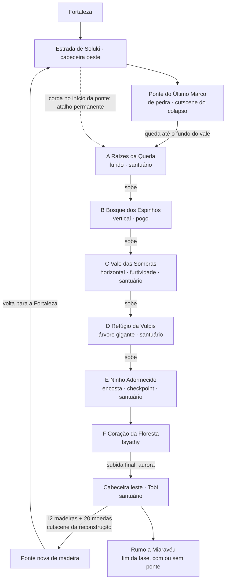

# Fase 02 — A Floresta Silenciosa: plano de implementação

> Fonte: `SeteVidasDocs/Castalia_GDD_Fase_02_Floresta_Silenciosa_v1_1.md` (v1.1) + 3 diretrizes do usuário (12/11/2026):
> (1) floresta grande mas não artificialmente longa; (2) furtividade da serpente com consequência, sem punição excessiva;
> (3) reconstrução da ponte satisfatória e engraçada, com animação da Tobi.
> Decisões do usuário (13/11/2026) incorporadas: nome **Fortaleza**; viagem rápida entre santuários; arqueira **Vulpis** (raposa);
> ponte por **20 moedas**; dano da Isyathy (meio coração no ninho; meio ou 1 no chefe); duas cutscenes da ponte; ponte nova de madeira com corda.
> Status: **[PROPOSTA]**. Valores numéricos são ponto de partida para playtest.

---

## 0. O que já existe e será reaproveitado

A Fortaleza deixou boa parte da base pronta. A Floresta é mais **conteúdo** do que **sistema novo**.

| Necessidade do GDD | Já existe | O que falta |
|---|---|---|
| Martelo quebra árvores rachadas | `BreakableWall` (marreta do Paladino, flag persistente `parede_quebrada_*`) | Variante visual de tronco, partículas de madeira, som grave; filtro de ferramenta explícito (`PaladinHammer`) |
| Pogo | `CombatController` + `DownAttackRules` + `PogoSurfaces` (espinhos já aceitam pogo) | Interface `IPogoTarget` para **inimigos com estado** (planta só no recuo, galho só vulnerável, cabeça da Isyathy só em janelas) |
| Furtividade e ruído | `NoiseSystem`, `StealthController`, `HidingSpot`, `LightZone`, `EnemyPerception`, `AlertBrain` | Medidor de alerta **global** da serpente (ver Fase F7) |
| Sentinelas infectados | `ZombieAI`, `ZombieRules`, `PoisonRules` | Variantes espada/escudo com silhueta militar |
| Chefe | `GoldenBoss`, `BossArena`, `ArenaGate`, `BossHealthBar`, `BossRules`, `BossAudio` | Chefe multiparte (cabeça interativa + corpo no fundo) e eventos de apoio da Vulpis |
| Checkpoints, save, flags | `Sanctuary`, `SaveManager`, `SaveData.flags`, `SaveData.scene` | Save por **cena/sala**, contador de madeiras, viagem rápida |
| Moedas, inventário, diálogo | `CoinPurse` (`TrySpend`), `InventoryMenu` (aba Itens), `DialogueRunner`, `DialogueTrigger` | Item Madeira de Reconstrução, baú, retratos novos |
| Plataformas que caem | `CrumblingPlatform` | Segmentos da ponte de pedra em colapso, plataformas destruídas pela serpente que se refazem |
| Parallax e cenário | `ParallaxLayer`, `SceneryLayers`, `AmbientEmitter`, `WindZone2D`, `BendOnPass`, `PulseLight` | Conjuntos da floresta e das ruínas dos Primatas |
| Música adaptativa | `MusicDirector` (cues Explore/Stealth/Combat/Boss/Sanctuary) | Cues da floresta, ruínas, corrupção, ninho, Isyathy, Vulpis, Tobi |

**Não existe e é obrigatório:** troca de cena entre salas, tela de mapa, viagem rápida, baú, sistema de cutscene (sequências roteirizadas).

---

## 1. Diretrizes do usuário aplicadas

### 1.1. Floresta grande, mas não artificialmente longa

O "4× a Fortaleza" deve ser medido em **conteúdo e decisões**, não em largura de corredor.

**Regras de level design:**
- Nenhum trecho com mais de **2 telas (≈60 tiles) sem decisão**: bifurcação, mudança de altura, inimigo, segredo ou atalho.
- **Subida gradual [APROVADO]:** o gato cai no fundo do vale e cada região fica **mais alta** que a anterior, até sair do **outro lado da ponte** (cabeceira leste). Descidas só curtas e locais.
- **Mistura de horizontal e vertical [APROVADO]**, com **muitas plataformas** (inspiração de *sensação*: Hollow Knight: Silksong): ~55% das salas verticais, ~45% horizontais com 2–3 alturas de plataforma; um apoio a cada 3 tiles de altura; cair custa tempo, não vida.
- **Atalhos para baixo**: como a fase sobe, voltar é descer (cipós soltos, portas abertas por cima, a corda da ponte).
- Regiões opcionais **curtas e densas** (uma sala-desafio + recompensa), nunca um braço longo e vazio.
- Rota crítica com alvo de **45–60 min** no primeiro jogo; coleta completa de **75–90 min**. Medir no graybox antes da arte.

**Topologia** (refinar no graybox):

Salas, baús e atalhos em detalhe: `Docs/Level/floresta-mapa.md` (rev. 2: 39 salas, subida de ~220 tiles).

- **Viagem rápida entre santuários** **[APROVADA]**: 5 santuários na Floresta (Raízes, Ravina, Refúgio da Vulpis, antes da arena, cabeceira leste). Com isso, voltar da Tobi para buscar madeiras é rápido.
- **Ponte nova** **[APROVADA]**: a antiga era de **pedra** e desaba; a nova é de **madeira**, liga a cabeceira leste (onde a subida termina) à oeste, ou seja, **libera a volta para a Fortaleza**. Tem uma **corda no início, do lado da Fortaleza**, que desce até o fundo do vale (atalho permanente).
- **A ponte aparece no fundo** de muitas salas, cada vez maior: o jogador sempre sabe quanto falta subir.
- **A Isyathy de longe [APROVADO]**: antes do ninho, olhos e silhueta aparecem no fundo em 5 lugares (mapa §6). Depois da morte, o **espírito** dela aparece nesses mesmos lugares e conversa com o Lion.
- O **mapa marca baús**: a sala visitada mostra o ícone do baú (aberto/fechado). Com 12 coletáveis, isso evita varredura às cegas.

### 1.2. Furtividade da serpente: consequência sem punição excessiva

Medidor de alerta global da Isyathy (0–100), alimentado pelo `NoiseSystem` existente:

| Faixa | Estado | Feedback (GDD §9.3) | Consequência |
|---|---|---|---|
| 0–24 | Dormindo | Respiração lenta | Nenhuma |
| 25–49 | Inquieta | Respiração acelera, trilha some | Nenhuma; aviso |
| 50–79 | Agitada | Escamas contraem, galhos tremem, olho abre no fundo | Corpo se contorce: **plataformas próximas balançam** (derrubam se o gato ficar parado nelas) |
| 80–100 | Busca | Rugido grave; a cabeça sai do fundo | A cabeça **procura a origem do último ruído**: aviso de 1,2 s no chão, depois bote que **destrói plataformas** naquela área. Acertar o gato: **meio coração** **[APROVADO]**, sem morte instantânea |

- **Ruído** (GDD §9.2) vira valor no `NoiseSystem`: parado 0, agachado 2, andando 5, correndo 12, atacando 25, quebrando árvore 60.
- **Recuperação:** escondido em folhagem/sombra, o alerta cai rápido (≈15/s); parado fora de cobertura, devagar (≈5/s); depois do bote, volta para ~60 (não zera).
- **Plataformas destruídas nunca bloqueiam a rota.** Ou se refazem (raízes crescem de volta em ~8 s), ou caem num caminho inferior que reconecta por escalada. Sem softlock.
- **Checkpoint no meio do ninho** + santuário antes da arena (GDD §9.4).
- **Rota limpa sem quebrar nada** sempre existe; a rota do martelo é mais curta e guarda uma madeira, mas custa ~60 de alerta.
- Telemetria de playtest: quantas vezes o jogador entrou em Busca e onde.

### 1.3. As duas cutscenes da ponte

**[APROVADO]** São duas cenas: o **colapso da ponte de pedra** (abertura, F3) e a **reconstrução em madeira** (fim, F9, depois de entregar os itens).

**Cutscene 1: colapso da ponte de pedra.** Fecha a fuga jogável (GDD §2.2): o jogador corre pelos segmentos que se rompem; no meio, o controle sai, os blocos centrais de pedra cedem sob a horda, Lion cai entre galhos, tela preta, acorda nas Raízes da Queda.

**Cutscene 2: reconstrução em madeira (satisfatória e engraçada).** Cutscene curta (**20–30 s**, pulável depois da primeira vez) com a Tobi exagerando nas ferramentas. Respiro de humor depois do trecho mais sombrio do jogo até aqui.

**Roteiro de batidas (proposta):**
1. Tobi estala os dedos e tira da mochila minúscula uma chave inglesa **maior do que ela**.
2. Lion entrega as 12 madeiras; elas caem empilhadas nos braços da Tobi, que cambaleia como uma torre de pratos.
3. Tobi **cava e some no chão** (é uma toupeira!), sai do outro lado do abismo puxando uma corda, que estica a primeira viga.
4. Nuvem de poeira de desenho animado: martelo, serrote, uma broca que gira a própria Tobi, estrelinhas e "plinks".
5. A poeira baixa: a ponte de **madeira** está pronta, com a corda amarrada no início, pendurada para a floresta. **Sobra uma madeira**; Tobi guarda no bolso: "Taxa de material."
6. Lion pisa, a ponte range alto, todos congelam... e aguenta. Tobi: "Garantia de... uns cinquenta anos. Talvez."

**Áudio:** música própria da Tobi (pizzicato/fagote em chiptune), SFX cômicos exagerados e mais altos que o normal da mixagem.

---

## 2. Fases de implementação

Cada fase termina com algo **jogável e testável**. Arte entra em todas as fases como placeholder e é finalizada nas fases de conteúdo. **Som: todo na F10** (decisão do usuário, 14/11/2026: as fases F3–F9 focam em game design, assets e gameplay; o que era áudio de cada uma está listado na F10).

### F0 — Pré-produção e decisões (sem código de gameplay)

- **Level:** mapa da floresta em papel/graybox de blocos com topologia, camadas e atalhos (§1.1). Posição provisória dos 12 baús, 5 santuários e do checkpoint do ninho. Documento `Docs/Level/floresta-mapa.md` com grafo de dependências (como `mapa.md`).
- **Design:** métricas de pogo por alvo (altura do impulso, janela, graça); fichas dos 5 inimigos novos; tabela de ruído/alerta.
- **Narrativa:** personalidade e arco da **Vulpis** (raposa, arqueira). Roteiro das falas da Estrada, Vulpis, Isyathy e Tobi.
- **Arte:** paleta da floresta (GDD §3.1) fechada em `.gpl`, com as cores da praga (#5b2a6e / #8fd14f) reservadas como na Fortaleza; guia visual "pogo válido vs. espinho comum" e "tronco rachado vs. tronco comum".
- **Áudio:** plano de músicas e SFX da floresta (skill de sound design).
- **Pronto quando:** mapa aprovado, lista de assets fechada, pontos abertos críticos resolvidos.
- **Estado (13/11/2026): documentos escritos, aguardando aprovação.**
  - Mapa (rev. 2, vertical e sempre subindo), 39 salas, baús, santuários, atalhos: `Docs/Level/floresta-mapa.md`
  - Pogo, martelo, baú, alerta da Isyathy, viagem rápida, mapa, arena: `Docs/Design/floresta-mecanicas.md`
  - Inimigos: `Docs/Design/floresta-bestiario.md`
  - Vulpis, Tobi, falas: `Docs/Narrativa/floresta-roteiro.md`
  - Paleta e leitura visual: `Docs/Arte/paleta_floresta.gpl`, `Docs/Arte/floresta-guia-visual.md`
  - Músicas, ambiências, SFX: `Docs/Audio/floresta-audio.md`

### F1 — Fundação técnica

- **Uma cena por região** + componente de transição (porta/borda de sala) com fade (`ScreenFader`), posição de entrada, e `SaveData.scene` respeitado ao carregar.
- **Persistência por sala**: inimigos, árvores quebradas, baús abertos e atalhos abertos lembrados entre cenas (flags existentes).
- **Câmera** com limites por sala, pensada para salas verticais (Cinemachine): olha para baixo ao cair; agachado e parado, desce 4 tiles.
- **Plataformas novas** (mapa §3): galho de **mão única** (pular por baixo; baixo + pulo desce), galho que balança, galho podre, folha larga que afunda, cogumelo saltador.
- **Falas curtas (barks)**: balão de 2 s sobre o Lion sem parar o jogo (quedas longas, primeiro infectado de cada tipo). Lista em `Docs/Narrativa/floresta-roteiro.md`.
- **Tela de mapa** (nova aba no `InventoryMenu`): salas visitadas, santuários, ícones de baú.
- **Viagem rápida**: lista dos santuários já visitados (no santuário ou na tela de mapa), com fade e troca de cena.
- **Baú + item Madeira de Reconstrução**: contador `Madeira de Reconstrução: 8/12` na aba Itens e aviso ao coletar.
- **`BreakableTree`**: generalizar `BreakableWall` com ferramenta permitida, para tronco rachado.
- **`IPogoTarget`**: pogo condicional por estado do alvo.
- **`CutsceneRunner`** simples (passos em sequência: mover, falar, animar, esperar, câmera, som), usado nas 2 cutscenes da ponte, na entrada da Vulpis e na Isyathy.
- **Música:** novos `MusicCue` (Forest, Ruins, Blight, Nest, Isyathy, Vulpis, Tobi) e ambiência por região.
- **Testes EditMode:** regras de pogo, contador de madeiras, persistência de flags por cena, transições, destinos da viagem rápida.
- **Pronto quando:** dá para andar entre duas cenas de teste, quebrar um tronco, abrir um baú, sair e voltar com tudo lembrado, e viajar entre dois santuários.
- **Estado (13/11/2026): implementado e em teste no Unity** (menu **20. Floresta F1: cenas de teste**, cenas A, B e C; roteiro em `Docs/QA/floresta-f1-plano-de-teste.md`). Inclui a **aba Mapa** (`MapRoom`, `MapRules`, `SaveData.mapRooms`), o **Cacto Flutuante** básico (`FloatingCactus`) e, pedido do usuário, **chave + porta trancada + sala-arena** (`KeyPickup`, `LockedDoor`, `ArenaRoom`, `KeyRules`/`ArenaRules`).
  - Código: `SceneTravel`/`RoomExit`/`RoomEntrance` (World/Travel), `TravelRules` + `TravelMenu` + `SaveData.visitedSanctuaries`, `BreakableWall` com material madeira (`BreakableRules`), `WoodChest` + `ReconstructionWood`, `IPogoTarget`, layer `Platform` + `OneWayPlatform`/`SwayingBranch`/`SinkingLeaf`/`BounceMushroom` (World/Forest), descida baixo + pulo no `GroundCheck`/`PlayerController`, `CameraLook`, `Cutscene`/`CutsceneRunner`, `SpeechBubble` + `LionBarks`, `MusicArea` + 7 `MusicCue` novos, capítulo 2 no Diário.
  - Testes: `ForestFoundationTests` (32). Cenas `Forest_Test_*` usam o save de testes (`SaveManager.IsTestScene`).

### F2 — Graybox jogável da floresta inteira

- Todas as regiões A–F em blocos, com rota crítica de ponta a ponta, atalhos funcionando e os 12 baús.
- Inimigos substituídos por placeholders (cubos com comportamento básico ou inimigos existentes).
- **Playtest de escala**: cronometrar rota crítica e coleta completa; cortar ou densificar trechos que violem a regra de "2 telas sem decisão".
- Teste de alcance: todas as madeiras alcançáveis só com Ladino + Paladino.
- **Pronto quando:** a floresta inteira é atravessável em graybox no tempo-alvo e sem softlock.
- **Estado (13/11/2026): graybox gerado, falta o playtest no Unity** (menu **21. Floresta F2: graybox (7 cenas)**; roteiro em `Docs/QA/floresta-f2-plano-de-teste.md`).
  - O mapa é **dado**: `Assets/_Game/Editor/ForestLayout.cs` (como o `FortressLayout`). As cenas `Forest_Road` e `Forest_A_Roots` … `Forest_F_Heart` são recriadas pelo menu: **ajuste o mapa no código, não na cena**.
  - Coordenadas globais (uma cena por região, todas no mesmo sistema): a aba Mapa junta as regiões sem deslocamento.
  - **Alcance conferido sem o Unity** (`ForestReach`, física aproximada do gato): os 12 baús, todas as saídas e atalhos, nenhum softlock, também só pela rota principal de cada cena. Rodar: `Tools/LevelPreview/checar_floresta.ps1` (gera um PNG por cena com o alcance pintado em `SeteVidasDocs/Referencias/floresta/`) ou o menu **21b**.
  - Pedidos do usuário aplicados: **muitas sombras, patrulhas e armadilhas** (60 sombras, 29 patrulhas, espinhos, serras, lâminas, fios de alarme, lanças, fogo, lançador); **atalhos que voltam para salas anteriores** (AT1–AT8, abertos do lado mais adiantado); **salas de movimento antes do chefe dormindo** (E1–E3: rampa + pogo, rampa + vinha, rampa que cai em outra rampa e pula na plataforma temporária, 20 ganchos para o caminho de volta com o Caçador); **sem volta da E5 até a Isyathy**.
  - Placeholders: Sentinela no lugar do Sentinela Infectado e da Serpente; Planta Carnívora nos "buracos de serpente". Estrada (R1–R5) só em esboço (a F3 faz de verdade).
  - Testes: `ForestGrayboxTests` (save do graybox, lado fechado do atalho).
- **Rev. 4 (13/11/2026, repaginada pedida pelo usuário): gerada, falta o playtest no Unity** (roteiro: `Docs/QA/floresta-rev4-plano-de-teste.md`; detalhes: `Docs/Level/floresta-mapa.md` §00).
  - **Mapa em anel** com posições à mão: as salas de depois passam por cima das de antes. Subida total de ~290 tiles (era ~670).
  - **Forest_Test_A/B/C dentro da fase**, com o desenho do usuário inteiro: A3, B1 e D3. A cabana virou a cena `Forest_D_Cabin`, e o S-T2 virou o **S-F1B**.
  - **Atalhos de verdade** (`ShortcutLink`): cipó que se solta, alçapão de raízes e poço. Ficaram 6, mais a corda da ponte.
  - **Inimigos da floresta:** templários zumbis (`ZombieSquad`) no lugar das sentinelas, **Serpente** nova (`ForestSnake`, do buraco ou rastejando), mais plantas e morcegos. Saíram os alarmes e as armadilhas dos templários.
  - **Salas orgânicas:** terreno, raízes e trechos de vinha alternados com pogo, mais cogumelos.
  - **Alcance mais exigente:** a planta não conta como pogo, vinha fora da parede é acusada e o mapa não pode ter salas sobrepostas.

### F3 — Abertura: Estrada de Soluki e colapso da ponte

- **Sentinela Canino Infectado**: variantes espada e escudo sobre o `ZombieAI` (escudo bloqueia de frente → ensina ataque pelas costas/martelo).
- Estrada com postos abandonados, tochas e sinais de luta (props novos), ligada à saída da Fortaleza.
- **Sequência da ponte de pedra**: horda avançando, segmentos de pedra que se rompem (`CrumblingPlatform` roteirizado) e **cutscene 1** (§1.3): colapso central, queda com câmera, tela preta, acordar nas Raízes.
- **Arte:** ponte canina de **pedra** (intacta, rachando, blocos caindo, destruída), sentinelas infectados.
- **Áudio:** → F10.
- **Narrativa:** falas curtas do Lion; objetivo novo "Reencontrar a ponte".
- **Estado (13/11/2026): primeira parte implementada, falta testar no Unity** (roteiro: `Docs/QA/floresta-f3-plano-de-teste.md`).
  - **Ligação Fortaleza → Estrada:** o gatilho do fim (`D-FIM`) passou a levar à `Forest_Road` (chegada `R1_oeste`) com a vida e o save, sem voltar ao menu. A conversa toca uma vez (`fortaleza_fim_visto`); depois é só passagem. A R1 volta para a Fortaleza (chegada `fortaleza_estrada`). `DialogueTrigger.loadEntranceAfter`; `FortressLayout.Version` 17; menu **13d** troca só a saída na cena aberta (sem recriar a fase).
  - **Luz de passagem** (pedido do usuário): toda saída para outra cena tem um clarão pontilhado na frente de tudo (`PassageLight`), dourado na Fortaleza e na estrada, verde-claro na Floresta; portas de atalho têm um clarão atrás. O **escuro do fim da Fortaleza virou luz** (o da entrada, no penhasco, continua).
  - **Infectados** (`ZombieSquad`, Templário Zumbi da Fortaleza como base): de espada e de **escudo** (`ZombieAI.GiveShield`, `ZombieRules.ShieldBlocks`: bloqueia golpe comum de frente; passa pelas costas ou com a marreta). R1 com posto abandonado e tochas; R2 com o de escudo embaixo da torre caída.
  - **Ponte** (`BridgeCollapse`): inteira até o gato pisar nela; então a horda nasce atrás (R3) correndo, a pedra treme e racha; no meio (ou depois de 10 s) o centro desaba, bloco por bloco, e o gato cai. A flag `ponte_caiu` vai para o save e libera o gatilho da queda, que leva à A1 com fade; lá o Lion fala ao acordar. Com a flag, a ponte já aparece caída (dos dois lados, cair leva à A1).
  - Falta da F3: arte de verdade (ponte de pedra, infectados caninos, props da estrada), câmera acompanhando a queda pela copa (hoje: queda + fade), objetivo "Reencontrar a ponte".

### Melhorias gerais (14/11/2026, pedido do usuário, antes da F4)

**Estado: implementado, falta testar no Unity** (roteiro: `Docs/QA/melhorias-gerais-plano-de-teste.md`; rodar antes os menus **13e** e **22**).
1. **Golpe para cima** em todas as armas ({subir} + ataque), `UpAttackRules`.
2. **Dano × 1,3 por coração novo** depois da maldição, `HeartDamageRules` ([PROPOSTA]: revisar no playtest).
3. **Koda: repulsa sagrada** contra ficar quicando na cabeça dele (`BossRules.PlayerAbove`/`ShouldRepel`, estados `RepelWindup`/`RepelActive`).
4. **Santuário com os dois avisos juntos**: [Interagir] descansar, [Ataque] viagem rápida; o menu lista só os santuários.
5. **Mapa do mundo estilo Hollow Knight** (Fortaleza + Estrada + Floresta), atalho **M / Exibir**: `WorldMapData`, `WorldMapRules`, `MapExplorer`, `Editor/WorldMapSetup.cs` (menu 22).
6. **A cura corta o veneno.**
7. **Atiradores do meio da Fortaleza** em lugares novos e mais atentos ("Fortaleza: atualizar sem recriar", `FortressLayout.Version` 18).
8. **Transições**: sai e entra andando pelas passagens laterais, cai pelos buracos; chegada de queda (A1_queda) com o gato despencando, deitado e levantando (`TransitionRules`, `RoomEntrance.Style`).

### F4 — Bestiário da floresta

Ordem pela região em que aparece. Cada um com variante **infectada** via componente modificador (mesma IA, parâmetros e visual diferentes):

| Inimigo | Base | Infectado | Pogo |
|---|---|---|---|
| Morcego Noturno | Dorme pendurado, desperta com ruído/proximidade, investida | Voo irregular, investidas seguidas | Não |
| Galho Seco | Patrulha, finge ser tronco, golpe de braço | Rachaduras luminosas, agressivo, nuvem tóxica ao morrer | Só vulnerável (após golpe) |
| Cacto Flutuante | Trajetória fixa; contato lateral fere | Trajetória menos previsível, dispara espinhos | Sim (topo) |
| Planta Carnívora | Estacionária, mordida | Alcance maior, esporos | Só no recuo após a mordida |
| Serpente da Floresta | Camuflada em raízes/buracos, bote rápido | Mais agressiva, ataque com veneno (`PoisonRules`) | Em padrões específicos |

- **Arte por inimigo:** parado, andar/voar, aviso (telegraph), ataque, recuo/vulnerável, dano, morte; versão infectada como troca de paleta + detalhes (olhos, rachaduras verdes).
- **Áudio por inimigo:** → F10 (até lá, a variante infectada usa os sons do zumbi).
- **Testes:** regras de pogo por estado, percepção (reuso de `PerceptionMath`).
- **Estado (14/11/2026): variante infectada implementada, falta testar no Unity** (rodar o menu **21**; roteiro: `Docs/QA/floresta-f4-plano-de-teste.md`). A versão básica dos 5 inimigos já vinha da F1/F2 (rev. 4).
  - **Componente `Infected`** (Enemies/Forest) no mesmo objeto da IA: a IA lê no Awake e troca os números (`ForestEnemyRules.*For(infected)`); o componente cuida do visual (troca cada sprite pelo `*_infectado.png`, tinge de roxo o que é feito na hora, pontinho verde dos olhos). Infectado tem **+1 de vida**.
  - **Galho Seco**: aviso 0,4 s, preso 0,7 s, olhos piscando no disfarce, **nuvem tóxica** 2 × 2 por 2 s ao morrer (`ToxicCloud`). **Broto** infectado solta morcegos infectados.
  - **Planta**: alcance 7, aviso 0,45 s, volta 0,5 s, **esporos** (1,5 tile, 1,5 s) a cada golpe, uma nuvem de cada vez.
  - **Serpente**: bote a 4 tiles, esticada 0,4 s, no buraco 1 s, **mordida envenena** (só se tirou vida). A folhagem continua escondendo.
  - **Morcego**: acorda a 9/7 do alcance normal e com barulho ≥ 0,2, voa a 5,5 em **zigue-zague**, recua só 0,35 s.
  - **Cacto**: trajetória tremida (Perlin, até 0,5 tile); a cada 3 s incha 0,5 s e solta **4 espinhos em cruz** (alcance 5, `EnemyBolt` com distância máxima). **Pronto no código, mas fora da Floresta** (pedido do usuário, 14/11/2026): fica para outras fases.
  - **Nuvem tóxica** envenena uma vez por nuvem (não deixa o veneno letal sozinha).
  - **Distribuição** (`ForestLayout.InfectionShare`, [PROPOSTA]): A sem infectados; B e C1–C3, 1 em 4; C4–C7 e D, metade (D3, o respiro da Vulpis, 1 em 4); E e F1, todos; G (volta), metade. Cactos sempre normais. `ForestLayout.Version` 11.
  - Sprites infectados gerados pelo editor (`ForestInfectedArt`, troca de paleta; o turquesa do pogo não muda). Testes: `ForestBestiaryTests` (10).
  - Falta da F4: arte de verdade por inimigo (animações completas), Sentinela Canino com silhueta canina.

### F4b — Vulpis, Caçador e a Chave do Templo (pedido do usuário, 14/11/2026)

**Correção (14/11/2026):** dava para pular por cima do Portão do Templo sem a chave; agora há parede até o teto em cima dele, com o portal de pedra (pilares e verga). Portão e grades da arena com arte nova (`ForestLoreGen`). **Estado: implementado, falta testar no Unity** (`Docs/Floresta/plano-f4b.md`; roteiro: `Docs/QA/floresta-f4b-plano-de-teste.md`; ficha: `Docs/Design/classe-cacador.md`; rodar os menus 21 e 22). Depois da arena do D3, sala nova com a Vulpis: vínculo (+1 coração, classe **Caçador**: arco, flecha com corda, dash); trecho de plataforma nas Ruínas do Templo (dash + gancho) até o baú da **Chave do Templo**, atrás de uma parede de ruínas; a passagem D4 → E1 vira o **Portão do Templo**, trancado. Chave da cabana e do templo com visuais diferentes. Adianta parte da F6 (Refúgio da Vulpis) e muda a ordem das classes do GDD (Caçador passa a 3º).

### F4c — Arte definitiva do bestiário (pedido do usuário, 14/11/2026)

**Estado: implementado, falta testar no Unity** (rodar `Tools/EnemySprites/gerar_floresta.ps1` (já rodado) e o menu **21**; roteiro: `Docs/QA/floresta-f4c-plano-de-teste.md`; detalhes: `Docs/Design/floresta-bestiario.md`, F4c).
- **Vespas da Raiz** no lugar do Morcego (insetos voadores), **Galho Seco/Broto** com as cores das árvores comuns (ambíguo com o cenário, com uma animação leve que denuncia), **Planta Carnívora** inspirada na planta de cano com identidade própria, **Serpente** refeita e a **toca camuflada no chão**.
- Animação por quadros nos inimigos (`ForestEnemy.Anim`, listas de quadros em `NightBat`, `DryBranch`, `CarnivorousPlant`, `ForestSnake`); a variante infectada sai da arte nova (menu 21). Testes: `ForestBestiaryArtTests`.
- Falta: Sentinela Canino com silhueta canina (hoje o templário zumbi) e o Cacto (fora da Floresta).

### F5 — Regiões A, B e C (conteúdo)

- **Tileset da floresta**: chão de terra/raiz, galhos plataforma (só topo sólido), troncos, espinhos comuns e espinhos de pogo, folhagem alta (esconderijo), água escura.
- **Ruínas dos Primatas**: concreto e vidro soterrados, estrada negra, escadarias, estação subterrânea com árvore no teto, torres enferrujadas com trepadeiras, placas ilegíveis, máquinas com luz discreta. Definir quais têm segredo e quais são só cenário.
- **Fundo e parallax**: céu índigo com lua, 3–4 camadas de árvores, névoa rasteira, vagalumes, fungos bioluminescentes (`PulseLight`), fachos de luar.
- **Região A** (tutorial do martelo e primeiro baú), **B** (pogo), **C** (furtividade e rotas alternativas), com santuários.
- **Corrupção progressiva**: densidade de infectados e vegetação enegrecida cresce em direção ao Coração.
- **Áudio:** → F10.
- **Narrativa:** placas/entradas de diário sobre os Primatas (sugerir, não explicar).
- **Estado (14/11/2026): parte 1 (cenário) implementada, falta testar no Unity** (rodar `Tools/EnvironmentSprites/gerar.ps1` e o menu **21**; roteiro: `Docs/QA/floresta-f5-plano-de-teste.md`). Vale para as 7 cenas, não só A–C.
  - **Tileset** (`ForestAutotile`, runtime, C# 5): solo, praga e concreto dos Primatas, com faixas musgo/terra/transição/rocha, **troncos** nas colunas finas, vinha (casca + hera de escalar), rampas 1:1 e 1:2, paredes do fundo. Material e praga por sala em `Editor/Scenery/ForestTerrain.cs` (concreto: A5, B4, C3, C5, G2; praga: C7, E, F1; praga chegando: C4–C6, D, G).
  - **Massa da floresta** fora das salas (tilemap sem colisão): as salas viram clareiras na mata; as aberturas da casca abrem um corredor. Na estrada, só embaixo.
  - **Fundo** (`ForestBackgrounds`): céu com lua, copas, árvores com fachos de luar, troncos próximos com névoa; versão praga no Ninho e no Coração.
  - **Detalhes e mundo vivo** (`ForestPainter`): samambaias que curvam, fungos azuis e brotos da praga que pulsam, raízes e vergalhão no teto; vaga-lumes, folhas e poeira da praga por sala.
  - Arte: `Tools/EnvironmentSprites/ForestSpriteGen.cs`. Prévia e conferência sem o Unity: `Tools/LevelPreview/ver_floresta.ps1` e `conferir_arte_floresta.ps1`. Testes: `ForestSceneryTests` (6).
  - Tetos da estrada soltos no céu: fica para a arte da estrada (F3). A parte 3 (ambiências e músicas) foi para a F10.
- **Parte 2 (14/11/2026): ruínas, placas, Diário e a Isyathy de longe. Implementada, falta testar no Unity** (rodar `Tools/EnvironmentSprites/gerar.ps1` e os menus **21** e **22**; roteiro: `Docs/QA/floresta-f5b-plano-de-teste.md`).
  - **Ruínas com segredo × só cenário** (guia visual: ruína com segredo mostra baú, alavanca ou parede quebrável na entrada):

    | Ruína | Sala | Tipo | O que tem |
    |---|---|---|---|
    | Placa da estrada | A2 | cenário | P-PRIM-01 (a primeira pista dos Primatas) |
    | Estação | A5 | **segredo novo** | passarela no alto (pelo teto do vagão A, com a serra) até a **cabine do chefe da estação**, fechada por blocos (marreta): 10 moedas e a P-PRIM-08. Também: P-PRIM-02 (mapa), relógio parado, bilheteria com luz verde, W03 (já existia) |
    | Torre Enferrujada | B4 | cenário (o segredo é o cipó do atalho) | P-PRIM-04 (a luz verde que pisca, de verdade), escada quebrada, máquina |
    | Prédio Soterrado | C3 | segredo (já existia: escritório com tronco rachado, W10) | P-PRIM-03 (vitrine), janelas que dão para a terra, escada quebrada, máquina |
    | Estrada Negra | C5 | cenário | P-PRIM-06 (a carroça de metal), postes de pé e caídos |
    | Templo | D6 | segredo (já existia: Chave do Templo) | P-PRIM-07 (lápide com primatas olhando para cima) |
    | Coluna dos Primatas | G2 | segredo (já existia: nicho de moedas) | P-PRIM-05 (painel do elevador) |
  - **Placas dos Primatas** (`LoreSign` com desenho próprio, textos em `Editor/ForestLore.cs`): 8 placas, P-PRIM-01 a 08. O gato descreve, não lê.
  - **Diário em todas as cenas** (`LoreBook`, `Resources/LoreBook.asset`, menus 13, 21 e **21c**): antes ele só listava as placas da cena aberta, e a Floresta tem uma cena por região. Agora lista toda placa lida, de qualquer cena, no capítulo dela.
  - **A Isyathy de longe** (`IsyathySighting`, mapa §6): **em todas as salas de A a D, a cada 5–11 s** (as salas do mapa §6 com a animação delas; as outras sorteiam: pescoço com a língua, olhos ou o corpo atravessando). aparece **de vez em quando, lá no fundo** (ordem −85, atrás das árvores médias e das névoas, paralaxe 0,08, pequena), numa animação curta, e some (pedido do usuário). Olhos que piscam (A4, C4; no lago somem se o gato agacha), corpo atravessando atrás das copas (B4), o pescoço que sobe entre as árvores, olha, se mexe, pisca e afunda (C6 e D4, maior na D4). Sem colisão; o lugar sai da câmera a cada vez (de um lado da tela, nunca em cima do gato); fala do Lion uma vez por jogo; somem com a flag `isyathy_morta` (o espírito é da F8).
  - **Documentos dos devotos** (D-DEVOTO-01 a 04) nas 4 cabanas abandonadas com baú: a gente que rezava para a Isyathy, da devoção ao medo.
  - **Corrupção progressiva:** já vinha da parte 1 (material por sala, brotos e poeira da praga) e da F4 (infectados por região).
  - Arte: `Tools/EnvironmentSprites/ForestLoreGen.cs` (prévia: `SeteVidasDocs/Referencias/floresta_ruinas_f5.png`). Testes: `ForestRuinsTests` (5). `ForestLayout.Version` 20.

### F6 — Refúgio da Vulpis

- Trilha de flechas presas nas árvores e criaturas abatidas (props).
- Cena: criatura infectada prestes a atacar, flecha a derruba, **Vulpis** no galho alto (`CutsceneRunner`).
- **NPC Vulpis** (raposa, feminina, arqueira): sprite (parado, mirar, atirar, saltar entre galhos), retrato com 3–4 expressões (tema musical: F10).
- Diálogo (GDD §8.1; as falas do "Arqueiro" passam a ser da Vulpis) + aviso sobre Isyathy e o caminho para a ponte. Sem desbloqueio da classe Arqueiro.
- Santuário e respiro (intensidade baixa).
- **Análise e conclusão (19/11/2026, pedido do usuário):** a F4b já tinha feito o NPC (arte animada, retratos), o vínculo na D5 com o **aviso sobre a Isyathy** (D-VULPIS-VINCULO: a praga na guardiã, o Templo, a chave) e o santuário S-F3. Na D2 "O Resgate" só havia duas placas provisórias. **Feito agora (falta testar no Unity; `ForestLayout` v41):**
  - **A cena do resgate** (`VulpisRescue`, `Editor/VulpisRescueSetup.cs`): ao entrar na D2, um Galho Seco infectado larga o disfarce na frente do gato; o controle sai, a Vulpis cai das folhas no galho do meio, puxa o arco e a flecha de magia verde derruba o tronco. Vem a **D-VULPIS-01** (o primeiro relance dela, com o aviso: "tem coisa muito maior que esse galho acordando nesta floresta") e ela some pelo alto. Uma vez por jogo (`cena_vista_vulpis_resgate`); o Galho da cena não volta.
  - **A trilha de flechas** (`ArrowProp`, desenhos em `VulpisTrailArt`): flechas dela cravadas no tronco e no chão da D1 e da D2, e vespas abatidas.
  - Não precisou: a D-VULPIS-02 (cabana) ficaria repetindo o vínculo (roteiro, decisão de 14/11/2026).

### F7 — Ninho Adormecido (furtividade da serpente)

- **Corpo da Isyathy no fundo**: segmentos animados (respiração, contração das escamas) com parallax, primeiro confundidos com raízes.
- **`IsyathyAlert`**: medidor global da §1.2, consome o `NoiseSystem`, dispara feedback por faixa.
- **Bote de busca**: aviso no chão, cabeça entra do fundo, destrói plataformas (que se refazem); acerto = **meio coração**.
- Folhagem e sombras como zonas de recuperação; troncos rachados opcionais (rota curta e barulhenta).
- Checkpoint no meio + santuário antes da arena.
- **Áudio:** → F10. O medidor de alerta precisa dar o retorno pela imagem (escamas, galhos, olho), sem depender do som.
- **Testes:** travessia sem detecção possível; nenhum estado de alerta gera softlock; recuperação do alerta.
- **A fuga (17/11/2026, mesmo dia): saiu.** Ficou só o registro em `Docs/Floresta/plano-f7-fuga.md`; o código (`IsyathyChase`, `ChaseRules`, `NestChaseTests`, `isy_caca_0..2`) foi apagado. Motivo, nas palavras do usuário: "não está ficando legal".
- **Dinâmica atual (17/11/2026, pedido do usuário): a Isyathy embaixo da terra.** Falta testar no Unity. Rodar o menu **Floresta: Ninho F7 (a Isyathy embaixo da terra, sem recriar a cena)** ou gerar as cenas (`ForestLayout.Version` 29). Roteiro: `Docs/QA/floresta-f7-plano-de-teste.md`.
  - **O despertar** (`IsyathyBurrow`, objeto "Isyathy (embaixo da terra)", montado pelo `Editor/NestSetup.cs`, onde está o trilho): ela dorme deitada **na frente da tela** na E1 (do bloco alto, por cima do vão dos espinhos, até a cabeça na rampa). O gato entra: "...Isso não é raiz.", o olho abre, a cabeça levanta e ruge para ele, arqueia, mergulha no patamar 14..19 e o corpo inteiro escorrega para dentro da terra. Fica a **cratera**. Falas depois: "Ela entrou na terra." e "Se o chão tremer, não fico parado." Cena pulável depois de vista (`cena_vista_ninho_despertar`).
  - **Os botes** (`BurrowRules`): de 3 a 5 s (o dobro de aparições, 17/11/2026; o 1º, 2,5 s depois do despertar), com o gato **no chão** da E1, E2 ou E3 e longe de santuário (4,5 tiles). A tela treme 1,1 s e o chão racha a 3,5 tiles do gato, de preferência na frente dele, sempre em chão reto e sem espinhos. Ela sai do buraco, se arma inclinada para trás, abre a boca, dá o bote onde ele estava (alcance 6,5) e volta para a terra. A mordida tira **um coração** (2 hits). Os galhos frágeis da E2 e da E3 quebram no bote (`FragileBranch`). Depois da morte dela (`isyathy_morta`), o Ninho fica quieto.
  - **A arte é feita em código** (pedido do usuário: anaconda tomada pela corrupção, machucada, olhos com brilho roxo). `IsyathyArt` tem o corpo de escamas oliva com as manchas de anaconda, o ventre amarelado, as feridas abertas e as veias roxas com pústulas; a cabeça (dormindo, acordada, mordendo) com o olho verde e o halo roxo; e a cratera. O `SerpentRaster` monta o corpo como um tubo contínuo que segue a cabeça pelo trilho, com uma onda correndo, e esconde o que está abaixo do chão na boca do buraco. O `SerpentRig` faz isso a cada quadro. Prévia: `Tools/EnvironmentSprites/previa_isyathy.ps1`. Testes: `NestBurrowTests` (14).
  - **Rota sem inimigos** na E1–E3, como estava: lá o perigo é ela.
  - **Da parte 1, fica no código mas fora do Ninho:** `IsyathyAlert`, `IsyathyRules`, os desenhos do bote (`isy_bote`) e os `NestAlertTests`. O tronco rachado continua emitindo `"tronco_quebra"` na quebra.
  - **Falta:** acertar o ritmo no playtest (intervalo, aviso, alcance); som do tremor e do bote (F10); deixar o gato acertar a cabeça dela durante o bote (hoje ela é intocável); a D-ISYATHY-00 nova na arena, se for preciso.

### F8 — Chefe: Isyathy, a Devoradora Silenciosa

- **Estado (17/11/2026): implementado, falta testar no Unity.** Gerar as cenas (`ForestLayout.Version` 32) ou, só a arena, o menu **Floresta: chefe Isyathy F8 (sem recriar a cena)**. Roteiro: `Docs/QA/floresta-f8-plano-de-teste.md`.
- **Refeita (17/11/2026, pedidos do usuário ao testar):** ela anda **dentro da terra pelas 4 bordas** da arena (chão, paredes e teto; um montinho de terra corre pela superfície e fere no chão), avisa (a superfície racha e brilha), sai, ataca **mirando no gato** (encara e prevê para onde ele vai) e **espera cansada** (a janela de bater). O corpo nunca sai inteiro: o que fica fora do interior da arena não é desenhado. Golpes: o Bote (do chão), o Avanço (da parede), a Descida (do teto, seguindo o gato); fase II: o **Arco** (a cabeça sai de um vão e o rabo do vizinho: dá para bater dos dois lados) e o **Cuspe** (3 bolas que viram **poças de veneno**; sem nuvens). Saíram a varredura, as mordidas em sequência, os esporos e o rugido que derrubava galhos. **Vida 162** (o triplo). Hitbox: a cabeça cobre o desenho; o corpo leva meio dano na espera e resvala fora dela.
- **A Vulpis (17/11/2026):** arte nova (raposa feminina de capuz verde, sem lanterna). Ao cruzar 65% e 30%, a **Casca da Praga** deixa a Isyathy imune; a Vulpis **chega pulando** no galho lateral do lado do gato, fala, fica na pose pronta (animada), e numa cena com o jogo pausado e zoom pula e atira a **flecha forte de magia verde**; a câmera segue a flecha até a cabeça, a casca estoura, o zoom volta e ela **vai embora**. O coração do Caçador no HUD brilha no mesmo verde.
- **A arena (17/11/2026):** sem as plataformas de pedra; galhos de madeira, galhos podres temporários (caem ao pisar) e 3 ganchos, em menor número (os vãos pedem dash). `ForestLayout` v33.
  - **`IsyathyBoss`** (objeto "Isyathy (chefe)" na F1, montado por `Editor/IsyathyBossSetup.cs`). Ela é a mesma anaconda corrompida do Ninho (`SerpentRig`) e luta **de dentro da terra**: sai de 5 buracos do chão (colunas sem plataforma em cima) para cada golpe e volta.
  - **Golpes:** o Bote Frontal, a Mordida Descendente (paira em cima do gato, com a sombra no chão como aviso, e fica presa), a Varredura Lateral (atravessa a arena rente ao chão), o Impacto no Solo (a onda pelo chão e pedrinhas), o Cuspe Corrompido (`PlagueSpit`), as Mordidas em Sequência, os Esporos (`ToxicCloud`) e o Rugido Profundo (derruba os galhos da arena, que voltam sozinhos).
  - **Fases:** a fase I tem os 4 primeiros golpes; a fase II tem todos; a fase III emenda até 3 golpes, e o último tira um coração.
  - **Regras:** em `IsyathyBossRules`. Vida 54. Só a cabeça leva dano (`IsyathyHead`), e só exposta (depois do bote, presa no chão); fora disso resvala. Pogo na cabeça sempre que ela está fora da terra.
  - **Vulpis:** fica na plataforma alta da direita e atira quando a vida cruza 65% e 30% (D-ISYATHY-65/30). A cabeça fica atordoada por 2,6 s e leva 1,5×.
  - **Morte:** D-ISYATHY-DERROTA e D-ISYATHY-ESPIRITO-01 em balões: o último rugido, a cabeça desaba, os olhos apagam, o espírito azul-claro sobe e fala, e o corpo some na terra. A flag `isyathy_morta` fica salva. Morrer na luta reinicia tudo.
  - **Barra do chefe:** a `BossHealthBar` agora aceita qualquer chefe (`IBossBarSource`), com o nome dela.
  - **A volta da fase toda** (pedido do usuário, 17/11/2026): os portões de raízes da F1 (o teto, para a subida G1–G3, e uma passagem nova de volta para a E6) abrem com a flag. Na E5 (que era "sem volta"), um cipó na parede da esquerda sobe até a chegada e volta para a E4. O `ForestReach` confere a arena com os portões abertos.
  - **Feito em 19/11/2026 (pedido do usuário; falta testar no Unity):**
    - **O espírito como NPC** (`IsyathySpiritNpc`) nos 5 lugares das aparições (A4, B4, C4, C6, D4), só depois da morte: aparece quando o gato entra na sala, no primeiro plano, e E abre a D-ISYATHY-ESPIRITO-02a–d em rodízio (primeiro as não ouvidas; a 02e só com a ponte nova). A arte é a do fim da luta (`IsyathySpiritArt`, de 18/11), em 60%.
    - **As falas da luta em assets** (`IsyathyBossSetup.CreateFightDialogues`): D-ISYATHY-00 (a chegada), D-ISYATHY-65 rev. 2 (a fala do gato ao ver a casca entrou nela), D-ISYATHY-30 (a 2ª casca) e D-ISYATHY-65b/30b (depois de cada flecha forte). Sem os assets, os balões continuam como reserva.
    - **A corrupção por fase:** as manchas roxas avançam pelo corpo (limiar 0,62 → 0,50 → 0,36: ~25%, ~45%, ~70%), as faíscas se multiplicam, na fase III aparecem veias roxas acesas, e a sombra da nuca avança pela cabeça até o queixo (`IsyathyArt.BlightThreshold`, `SerpentRig.Corruption`). Troca no rugido de cada fase, com uma onda de faíscas da nuca ao rabo.
  - **Falta:** sons (F10: feito, ver abaixo).

- **Arquitetura:** `IsyathyBoss` com máquina de fases (100–65, 65–30, 30–0) e transições próprias, reaproveitando `BossArena`, `ArenaGate`, `BossHealthBar`, `BossRules`.
- Só **cabeça e pescoço** têm colisão/hitbox; corpo no fundo.
- **Fase I:** Bote Frontal, Mordida Descendente, Varredura Lateral, Impacto no Solo; janela de cabeça exposta (dano + pogo).
- **Fase II:** Cuspe Corrompido, Mordidas em Sequência, Esporos da Praga (zonas temporárias), Rugido Profundo (altera plataformas).
- **Fase III:** versões encadeadas; pogo na cabeça para passar perigos.
- **Dano** **[APROVADO: golpes de meio e de 1 coração]**; a divisão por golpe é proposta. Lion tem só **2 corações** (4 meios) após a maldição.

  | Meio coração (leves, aviso curto) | 1 coração (pesados, aviso longo) |
  |---|---|
  | Bote Frontal | Mordida Descendente |
  | Mordidas em Sequência (cada mordida) | Varredura Lateral |
  | Cuspe Corrompido | Impacto no Solo (estar embaixo da cabeça) |
  | Esporos da Praga (por toque) | Golpe final das combinações da Fase III |
  | Onda do Impacto no Solo e pedrinhas caindo | |

  Regra de leitura: **quanto maior o aviso, maior o dano**. O Rugido Profundo não fere; ele só muda as plataformas.
- **`ArcherSupport`** (Vulpis): eventos ligados a limiar de vida/estado (65%, 30%, janela final): flecha → reação → janela de vulnerabilidade. Posição segura se o jogador estiver em lugar incomum. Nunca dá o golpe final.
- **Derrota = morte [APROVADO]:** um último rugido, a cabeça desaba, o brilho verde dos olhos apaga e o corpo para de respirar. **A praga não tem cura.** Logo depois, o **espírito da Isyathy** sobe do corpo (translúcido, azul-claro e âmbar), fala com o Lion e a Vulpis e some entre as árvores. Ele fica livre na floresta e reaparece em 5 lugares para conversas opcionais. Falas: D-ISYATHY-DERROTA e D-ISYATHY-ESPIRITO-01/02 em `floresta-roteiro.md`.
- **Espírito (NPC):** sem colisão, interagível, aparece só com a flag `isyathy_morta`; arte de cabeça e pescoço translúcidos com brilho (voz: F10).
- **Arte:** cabeça grande com quadros por ataque (aviso, bote, recuo, exposta, atordoada pela flecha), estágios de corrupção por fase, projéteis, esporos, arena com plataformas e galhos da Vulpis.
- **Áudio:** → F10.
- **Testes:** `BossRules` por fase, gatilhos da Vulpis, plano de teste do chefe.

### F9 — Retorno, Tobi e a ponte

- **Estado (17/11/2026): implementado, falta testar no Unity.** Gerar as cenas (`ForestLayout.Version` 34) ou o menu **Floresta: Tobi e a ponte F9 (sem recriar a cena)**. Roteiro: `Docs/QA/floresta-f9-plano-de-teste.md`.
  - **Tobi** (toupeira engenheira, feminina): arte em `Tools/CharacterSprites/TobiSpriteGen.cs` (`gerar_tobi.ps1`): óculos de solda na testa, focinho comprido rosa, mãos enormes de cavar, lenço vermelho, avental e a mochila de ferramentas maior do que ela. 12 animações (parada, falando, gananciosa, ofendida, orgulhosa, a chave inglesa, carregando as tábuas, cavar, sair da terra, puxar a corda, martelar, a broca girando) e 4 retratos (animada, ofendida, gananciosa, orgulhosa).
  - **Onde:** na beira leste do abismo (R4, x 127), olhando a ponte caída; o S-F5 fica logo depois, na R5. Ao chegar na R5 (vindo da G3), a fala da aurora (D-SAIDA-01, uma vez).
  - **Conversas** (`TobiNpc`, `TobiRules`, assets em `TobiSetup.CreateDialogues`): o encontro acontece sozinho ao chegar perto (D-TOBI-01/01b); depois, E: faltam tábuas com a conta (D-TOBI-02), faltam moedas (D-TOBI-03) ou a reconstrução; depois da ponte, falas em rodízio (D-TOBI-05a/b/c).
  - **A reconstrução (cutscene 2):** paga as 20 moedas e grava `ponte_reconstruida`; a chave inglesa maior do que ela; as 12 tábuas voam do gato para os braços dela, que cambaleia ("Segura... segurei!"); ela cava e some; a câmera atravessa o abismo e ela sai do chão do lado da Fortaleza puxando a corda; a nuvem de obra (martelo, broca, estrelinhas) volta para o leste montando a ponte tábua por tábua, com a câmera junto; ela pula do chão ao lado do gato ("taxa de material"); o gato pisa, a ponte range, silêncio... e aguenta (D-TOBI-04).
  - **A ponte nova** (`RebuiltBridge`): 104 tiles de tábuas variadas com corrimão de corda e vigas em X, no lugar da de pedra; a corda pendurada no começo (lado da Fortaleza) é a volta para as Raízes (o gatilho A1_corda já existia com a flag). Com ela, a volta para a Fortaleza fica aberta pela R3–R1.
  - **Falta:** sons (F10); a saída para Miaravéu (a fase ainda termina na R5).

- Subida final do Coração até a **cabeceira leste** (o outro lado da ponte), com a aurora no topo, + santuário ao lado da Tobi.
- **Tobi**: sprite (parado, falar, cavar/emergir, ferramentas exageradas: chave gigante, martelo, serrote, broca giratória, puxar corda, guardar a madeira), retrato com 4 expressões.
- Diálogo (GDD §11.1) e contagem das madeiras que faltam ("Faltam 3. E eu não trabalho fiado!"); dica de onde procurar usando o mapa.
- **Opcional [APROVADO]:** entrega das 12 madeiras + **20 moedas** (`CoinPurse.TrySpend(20)`; sem saldo, a Tobi recusa com humor).
- **Cutscene 2: reconstrução em madeira** (§1.3). Flag `ponte_reconstruida` no save: ponte nova permanente, **volta para a Fortaleza liberada** e **corda no início da ponte** descendo para as Raízes (atalho permanente).
- **Áudio:** → F10.

### F10 — Polimento, mixagem e QA

- **Todo o som da Floresta** (decisão do usuário, 14/11/2026: as fases F3–F9 ficam sem som novo; plano de base em `Docs/Audio/floresta-audio.md`):
  - **F3, Estrada e ponte:** pedra rachando e desabando, horda gemendo, música de fuga.
  - **F4, bestiário:** por inimigo, idle, alerta, ataque, dano e morte; sons próprios da variante infectada (hoje usa os do zumbi).
  - **F5, regiões:** ambiências viva, ruínas e corrompida; músicas de exploração da floresta e das ruínas; as aparições da Isyathy de longe com respiração muito baixa (mapa §6); a luzinha e as máquinas dos Primatas (zumbido baixo, opcional).
  - **F6, Vulpis:** tema curto.
  - **F7, Ninho:** música e natureza diminuem ao avançar; respiração colossal como camada principal, mais rápida e grave conforme o alerta.
  - **F8, Isyathy:** tema em 3 camadas (uma por fase), rugidos, cuspe, impacto, flecha da Vulpis com prioridade alta; voz do espírito (eco grave e suave).
  - **F9, Tobi:** tema da Tobi (pizzicato/fagote em chiptune), SFX cômicos exagerados, jingle de conclusão.
- Mixagem final (prioridade: respiração da Isyathy, árvores quebrando, flechas da Vulpis).
- **Estado (19/11/2026): o som da Floresta implementado, falta ouvir no Unity** (rodar `Tools/Audio/gerar_sfx.ps1` e `Tools/Audio/importar_vozes.ps1` (já rodados) e gerar as cenas, ou o menu **Floresta: som F10 (sem recriar as cenas)**; detalhes em `Docs/Audio/floresta-audio.md` §Implementação).
  - **SFX** (`Tools/Audio/SfxBankForest.cs`, ~190 arquivos): tronco rachado, baú, madeira, galhos, atalhos, colmeia, a leva da arena, pogo por superfície; os 4 inimigos com aviso, ataque, dano e morte e a **variante infectada própria** (`_inf`, com o timbre da praga, como o zumbi); a Isyathy inteira (respiração em 4 níveis, tremor, saída, bote, mordida, impacto, rugido e rugido da praga, cuspe, poça, casca, derrota, o arrasto embaixo da terra); a Vulpis (arco, flecha, magia, o motivo de 3 notas); a ponte de pedra e a horda; os cômicos da Tobi (+3 dB na cena) e o jingle da ponte.
  - **Vozes:** a Vulpis usa a gravação `EfeitosSonoros/Audio-vulpis.wav` (cortada nas pausas, 6 emoções × 3); a Tobi e o espírito, sintetizados.
  - **Ambiência** (`AmbienceZone`, uma por sala): viva, ruínas, corrompida, ninho (cada sala mais quieta) e estrada, com sons pontuais (coruja, galho caindo, sapo, a máquina dos Primatas). No Ninho, a respiração dela é a camada principal e acelera perto do bote.
  - **Música:** o diretor de música nas 7 cenas, com áreas (ruínas, corrompida, ninho, Vulpis, Tobi, espírito), a Isyathy como chefe e o silêncio total depois da morte dela. **As faixas são do usuário** (como as do Treblo): enquanto `mus_floresta_*.wav` não existem, cada momento segue a faixa que já toca; o santuário usa a da Fortaleza.
- Playtests: escala e tempo, legibilidade de pogo e de troncos rachados, punição no ninho, dificuldade da Isyathy com e sem apoio da Vulpis.
- Planos de teste em `Docs/QA/floresta-*-plano-de-teste.md` por fase.
- Ajuste de posição dos baús e checkpoints (GDD §16.7).

---

## 3. Lista consolidada de assets

### Personagens e chefes
| Asset | Animações |
|---|---|
| Vulpis (raposa arqueira) | parado, mirar, atirar, saltar, retrato (3–4 expressões) |
| Tobi | parado, falar, cavar/emergir, chave gigante, martelo, broca giratória, puxar corda, cambalear com madeiras, guardar madeira; retrato (4 expressões) |
| Isyathy (cabeça) | ocioso, aviso, bote, mordida de cima, varredura, cuspe, rugido, exposta, atordoada, derrota; 3 estágios de corrupção |
| Isyathy (corpo) | segmentos de fundo: respiração, contração, deslizar, arrastar-se para o fundo |
| Lion | queda/acordar (colapso), entrega das madeiras, reação ao ranger da ponte, descer pela corda |

### Inimigos
Sentinela infectado (espada, escudo), Morcego, Galho Seco, Cacto Flutuante, Planta Carnívora, Serpente da Floresta, cada um com a variante infectada.

### Cenário
Tileset da floresta; galhos plataforma; espinhos comuns vs. de pogo; tronco rachado (inteiro, danificado, quebrado); folhagem alta; baú + madeira; santuário da floresta (variação do felino); ponte canina de pedra (intacta, rachando, destruída); ponte nova de madeira + corda; ruínas dos Primatas (fachadas, escadas, estrada, estação, torres, placas, máquinas); props da estrada (postos, tochas, armas caídas); flechas nas árvores; ossadas e escamas do ninho; fundos em parallax; partículas (lascas de madeira, esporos, vagalumes, névoa, poeira cômica).

### Áudio
- **Músicas:** Estrada/fuga, Floresta (exploração), Ruínas, Corrompida, Ninho (quase silêncio), Isyathy (3 camadas), Vulpis (tema), Tobi (tema), jingle da ponte.
- **Ambiências:** floresta viva, ruínas, corrompida, ninho.
- **SFX:** tronco rachado (golpe, quebra), baú, madeira coletada, pogo em cada superfície, 5 inimigos + variantes, respiração/alerta da Isyathy, ataques da Isyathy, flecha, pedra desabando, ponte de madeira rangendo, corda, ferramentas da Tobi.

---

## 4. Decisões

| Data | Decisão | Status |
|---|---|---|
| 13/11/2026 | A primeira fase se chama **Fortaleza** (o GDD diz Cidadela) | [APROVADA] |
| 13/11/2026 | Viagem rápida entre santuários | [APROVADA] |
| 13/11/2026 | A arqueira é **Vulpis**, raposa, feminina | [APROVADA] |
| 13/11/2026 | Reconstrução da ponte: 12 madeiras + **20 moedas** | [APROVADA] |
| 13/11/2026 | Isyathy fora da luta: cada ataque tira **meio coração**. No chefe: golpes de **meio** e de **1 coração** (divisão em F8) | [APROVADA] (divisão: [PROPOSTA]) |
| 13/11/2026 | Duas cutscenes: colapso da ponte e reconstrução | [APROVADA] |
| 13/11/2026 | Ponte antiga de pedra; nova de madeira, com corda no início que desce para a floresta; reconstruída, libera a volta para a Fortaleza | [APROVADA] |
| 13/11/2026 | A serpente se chama **Isyathy** (não confundir com Sethra) | [APROVADA] |
| 13/11/2026 | Infectados usam os sons do zumbi por enquanto; sons próprios depois | [APROVADA] |
| 13/11/2026 | Corda **no início da ponte** (lado da Fortaleza) | [APROVADA] |
| 13/11/2026 | Isyathy é **morta de verdade** (a praga não tem cura); o **espírito** dela fica livre na floresta e fala com o Lion. Antes da luta, olhos e silhueta aparecem no fundo | [APROVADA] |
| 13/11/2026 | A ponte é **opcional**: bônus para circular (volta para a Fortaleza, corda) e acesso a áreas futuras. A fase termina pela estrada de Miaravéu | [APROVADA] |
| 13/11/2026 | Floresta bem vertical, com muitas plataformas (sensação de Silksong), misturando trechos horizontais e verticais, **sempre subindo** até o outro lado da ponte | [APROVADA] |
| 13/11/2026 | Lion espantado com a praga se espalhando; sarcástico por cair de novo | [APROVADA] |
| 13/11/2026 | Uma cena Unity por região | [PROPOSTA] |
| 13/11/2026 | O fim da Fortaleza leva direto à Estrada de Soluki (sem voltar ao menu); a 3ª fala do D-FIM troca "Fim da demonstração" por "A estrada para Miaravéu segue para o leste, pela Ponte do Último Marco." | Ligação: [APROVADA]; texto: [PROPOSTA] |
| 13/11/2026 | Toda passagem para outra cena ou cenário tem uma luz na saída; o escuro do fim da Fortaleza vira luz | [APROVADA] (pedido do usuário) |
| 13/11/2026 | Atalhos para salas anteriores: cada um **abre do lado mais adiantado** e depois funciona nos dois sentidos | [APROVADA] (pedido do usuário) |
| 13/11/2026 | Atalhos são **passagens de verdade, estilo Dark Souls** (cipó que se solta, alçapão, portão), nunca portas que teletransportam. Para isso a floresta virou um **anel** (as salas de depois passam por cima das de antes) | [APROVADA] (pedido do usuário); o anel: [PROPOSTA] |
| 13/11/2026 | Na floresta não há templários vivos nem alarmes: a praga infectou a Ordem, e as patrulhas são **templários zumbis** | [APROVADA] (pedido do usuário) |
| 13/11/2026 | Plataformas orgânicas e com desafio (terreno, raízes, inimigos da floresta como **serpentes pequenas** e plantas carnívoras), vinhas misturadas ao pogo e mais cogumelos | [APROVADA] (pedido do usuário) |
| 13/11/2026 | `Forest_Test_A/B/C` entram na fase como **A3, B1 e D3**, com o desenho do usuário; o S-T2 vira o **S-F1B** e o S-T1 sai (a A2, ao lado, tem o S-F1) | Entrar na fase: [APROVADA] (pedido do usuário); lugares e santuários: [PROPOSTA] |
| 13/11/2026 | Salas antes do chefe dormindo (E1–E3) com rampas, pogo, vinhas e plataformas temporárias, e **vários ganchos** para o caminho de volta com o Caçador | [APROVADA] (pedido do usuário) |
| 13/11/2026 | Chegando à sala do chefe dormindo (E5), **não há volta**: a furtividade vai até a arena. S-F4 passa da Antessala (E6) para a Clareira do Musgo (E4), antes do trecho sem volta | Sem volta: [APROVADA]; S-F4 na E4: [PROPOSTA] |
| 14/11/2026 | **Todo o som fica para a F10** (F3–F9 focam em game design, assets e gameplay) | [APROVADA] (pedido do usuário) |
| 14/11/2026 | Ruínas com segredo: Estação (cabine nova), Prédio, Templo e Coluna; só cenário: placa da A2, Torre e Estrada Negra | [PROPOSTA] |
| 14/11/2026 | Placas P-PRIM-05 a 08 (painel, carroça, lápide, cabine) com texto novo | [PROPOSTA] |
| 14/11/2026 | O Diário lista as placas lidas de qualquer cena (catálogo `LoreBook`) | [PROPOSTA] |
| 14/11/2026 | **Toda aparição da Isyathy fica no fundo**, atrás das árvores médias e das névoas, com paralaxe (pedido do usuário: "escondida junto com as névoas e árvores"); o lago virou olhos do outro lado da água. Placas sem cavalo puxando carga (neste mundo os cavalos também evoluíram) | [APROVADA] (pedido do usuário) |
| 14/11/2026 | Aparições da Isyathy com falas curtas do Lion (balão, sem parar o jogo), também a D-MIRANTE-01; nova: "...Raiz não se mexe assim." (C6). A regra "nunca numa sala com combate" do mapa §6 não vale na B4 (morcego) nem na D4 (templário e serpente): ficou como o mapa definiu as salas | [PROPOSTA] |
| 17/11/2026 | **O Ninho vira uma fuga** (estilo das fugas do *Ori*): a Isyathy acorda ao entrar na E1 e persegue até a E4; **encostar mata**, com volta imediata ao começo do trecho. Substitui a furtividade do Ninho, o "meio coração fora da luta" (no Ninho) e o despertar na entrada da arena | [APROVADA] (pedido do usuário) |
| 17/11/2026 | Começa na E1, termina entalada na entrada da E4 (S-F4), morrer volta ao começo do trecho, música fica na F10 | [PROPOSTA] (o usuário mandou implementar sem escolher) |
| 17/11/2026 | **Sai a fuga; a Isyathy fica embaixo da terra:** acorda na frente da tela na E1, entra no chão (cratera) e, de tempos em tempos, a tela treme e ela sai para dar o bote (um coração) e volta para a terra. Arte nova em código: anaconda corrompida, machucada, olhos verdes com brilho roxo | [APROVADA] (pedido do usuário) |
| 17/11/2026 | **A Isyathy aparece o dobro no Ninho** (intervalo de 3 a 5 s entre os botes; antes era de 6 a 10 s). O movimento ficou mais orgânico: trilhos curvos sem quinas, a onda do corpo correndo com a velocidade, a cabeça seguindo o gato na mira, o recuo antes do bote, o bote em arco que passa do ponto, a mordida sacudindo e o corpo se contorcendo ao entrar na terra | [APROVADA] (pedido do usuário) |
| 17/11/2026 | **Galho Seco:** a flecha tira só 35% (o resto fica guardado para a próxima), então ele aguenta uns 15 tiros. De perto, nada muda. Ganhou animação de morte: estala, tomba para longe do gato, bate no chão (lascas, poeira) e some | [APROVADA] (pedido do usuário) |
| 17/11/2026 | **Vespas da raiz:** cada uma dorme numa **colmeia** pendurada no teto. Ao morrer, **20%** de chance de soltar **mel**, que cura meio coração | [APROVADA] (pedido do usuário) |
| 17/11/2026 | **Ponte do Último Marco (R4):** o dobro do tamanho, crescendo para a esquerda (52 tiles). Na cena, **o gato foge sozinho** até o meio, e a ponte **só treme com 3 ou mais zumbis em cima** (o peso da horda e do herói); depois de 1,6 s tremendo, o meio desaba. A horda nasce na cabeceira da R4 | [APROVADA] (pedido do usuário) |
| 17/11/2026 | **Olhos da Isyathy nas aparições:** continuam verde-amarelados, mas com um halo **roxo** da praga que pulsa (mais forte com o olho aberto) | [APROVADA] (pedido do usuário) |
| 17/11/2026 | **Ponte de novo dobrada: 104 tiles (52 blocos), e a horda com 8 zumbis** que aceleram e freiam (até 2,6× a corrida) para chegar amontoados logo atrás do gato. Ele para no meio e diz "...Será que a ponte aguenta tanto peso?" com a ponte já cheia de zumbis perto dele; 1,6 s depois, desaba. Durante a fuga (controle travado), a horda não fere o gato | [APROVADA] (pedido do usuário) |
| 17/11/2026 | **F8 feita: a luta com a Isyathy** saindo dos buracos da arena (a mesma anaconda do Ninho), 3 fases, cabeça só leva dano exposta, a Vulpis atordoa a 65% e 30%, morte com o espírito. Depois dela, a fase inteira tem volta: o teto e a passagem para a E6 abrem, e a E5 ganha um cipó até a chegada | [APROVADA] (pedido do usuário) |
| 17/11/2026 | Olhos das aparições: **um par por vez** na tela (e 2,5 s de descanso entre um e outro), intervalo de 4 a 8 s. Botes no Ninho: **4 a 5 por caminho** (2,5 a 4 s; atacam também com o gato pendurado ou no ar, saindo do chão embaixo dele). **Mel vira item** do inventário (até 9; comer cura meio coração; ícone de potinho) | [APROVADA] (pedido do usuário) |
| 19/11/2026 | **A montanha da R5** (desenho do usuário): a borda de baixo dela é o teto da sala, descendo em 3 degraus da esquerda para a direita (58, 53 e 38; a sala foi para 60 de altura), com pontas de rocha irregulares; a massa continua acima e a leste da sala (`Region.Peaks`). As pedras caídas da saída para as cachoeiras ficam num vão do degrau de baixo, em cima do último galho. **Três cachoeiras no fundo** (`WaterfallSetup`): caem da montanha até a névoa, com paralaxe na horizontal e a água animada (8 quadros); a do meio cai pelo buraco da G3. `ForestLayout` v40 | [APROVADA] (pedido do usuário) |

| 19/11/2026 | **Melhorias:** colmeia no Broto (as vespas saem dela); as levas da arena chegam do fundo para a frente; mais 3 vespas na arena do D3; convite da Tobi para a lojinha em Miaravéu (D-TOBI-06); o espírito da Isyathy em 5 lugares; as falas da luta em assets; a corrupção cresce por fase; a F6 completa (resgate e trilha de flechas); o som da Floresta (F3–F9) e a mixagem; a voz da Vulpis da gravação `Audio-vulpis.wav`. `ForestLayout` v41 | [APROVADA] (pedido do usuário); textos novos: [PROPOSTA] |
| 19/11/2026 | **Ponte do Último Marco mais rápida** (pedido do usuário: "está demorando muito"): o gato foge a 80% da corrida (era 60%) e a ponte desaba a 30 tiles da cabeceira (x 46 da R4; era no meio, x 68); a fala e o tremor antes do colapso caem para 1,1 s e 0,9 s (eram 1,6 e 1,6); segurança em 8 s (era 14). De ~15 s para ~6 s. **A horda nasce fora da tela**, à esquerda (na R3), em fila, e acelera até 3,4× para alcançar o gato (`BridgeRules.OffscreenX`, `ZombieSquad.SpawnAll`). `ForestLayout` v42 | [APROVADA] (pedido do usuário); os números: [PROPOSTA] |
| 19/11/2026 | **Estaca do atalho do patamar (B1) no chão firme**: ficava em cima da tampa de raízes e flutuava sobre o buraco depois de soltar o cipó. O gerador agora tira qualquer estaca de cipó de cima de uma tampa. **Mel sem limite** no bolso (era 9; o inventário mostra só a quantidade). `ForestLayout` v43 | [APROVADA] (pedido do usuário) |
| 19/11/2026 | **Sombra projetada** (pedido do usuário: "um sistema de sombra dinâmico, onde a sombra reflete o asset que ela está projetando"): o `ShadowProjector` lê a silhueta de quem faz a sombra (os pixels da árvore, ou o teto) e a arrasta para baixo e para a direita até o chão (`ShadowCast.Sweep`, a lua no alto à esquerda); funciona também no editor (mover a árvore leva a sombra). A zona de furtividade continua o retângulo. A copa das árvores de sombra ficou redonda (contorno em elipse, sem a base achatada). **Sem árvore** embaixo de teto ou na frente de parede de fundo: as duas da C3 (o Prédio Soterrado) e a da E1 viraram sombra do teto. `ForestLayout` v44 | [APROVADA] (pedido do usuário) |
| 19/11/2026 | **A Vulpis vai para o templo**: com a Chave do Templo, perto dela no posto (D5), a D-VULPIS-CHAVE abre sozinha ("Te encontro no templo") e ela some pelas copas; o posto fica vazio (`VulpisDeparture`, flag `vulpis_foi_templo`). **Galho Seco com o dobro de vida** (12; era 6). **Sem os casulos claros** na copa do Broto (as vespas saem da colmeia). **Sem os textos provisórios** (placas brancas do graybox) no jogo todo: `TrapsSetup.Sign` não cria mais nada, e o menu "Remover os textos provisórios" limpa as cenas já geradas | [APROVADA] (pedido do usuário) |

### Ainda em aberto
1. Arco futuro da Vulpis.
2. As músicas da Floresta (MUS-F01..F14): compostas pelo usuário; os nomes de arquivo esperados estão em `Docs/Audio/floresta-audio.md`.
