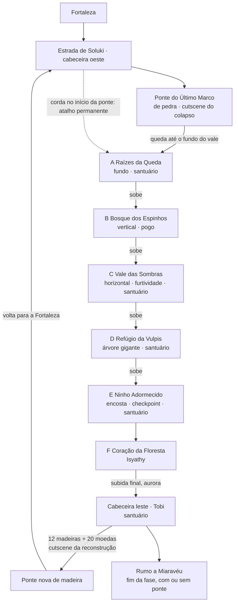

# Fase 02 — A Floresta Silenciosa: plano de implementação

> Fonte: `SeteVidasDocs/Castalia_GDD_Fase_02_Floresta_Silenciosa_v1_1.md` (v1.1) + 3 diretrizes do usuário (12/11/2026):
> (1) floresta grande mas não artificialmente longa; (2) furtividade da serpente com consequência, sem punição excessiva;
> (3) reconstrução da ponte satisfatória e engraçada, com animação da Tobi.
> Decisões do usuário (13/11/2026) incorporadas: nome **Fortaleza**; viagem rápida entre santuários; arqueira **Vulpis** (raposa);
> ponte por **20 moedas**; dano da Isyathy (meio coração no ninho; meio ou 1 no chefe); duas cutscenes da ponte; ponte nova de madeira com corda.
> Status: **[PROPOSTA]**. Valores numéricos são ponto de partida para playtest.

---

## 0. O que já existe e será reaproveitado

A Fortaleza deixou boa parte da base pronta. A Floresta é mais **conteúdo** do que **sistema novo**.

| Necessidade do GDD | Já existe | O que falta |
|---|---|---|
| Martelo quebra árvores rachadas | `BreakableWall` (marreta do Paladino, flag persistente `parede_quebrada_*`) | Variante visual de tronco, partículas de madeira, som grave; filtro de ferramenta explícito (`PaladinHammer`) |
| Pogo | `CombatController` + `DownAttackRules` + `PogoSurfaces` (espinhos já aceitam pogo) | Interface `IPogoTarget` para **inimigos com estado** (planta só no recuo, galho só vulnerável, cabeça da Isyathy só em janelas) |
| Furtividade e ruído | `NoiseSystem`, `StealthController`, `HidingSpot`, `LightZone`, `EnemyPerception`, `AlertBrain` | Medidor de alerta **global** da serpente (ver Fase F7) |
| Sentinelas infectados | `ZombieAI`, `ZombieRules`, `PoisonRules` | Variantes espada/escudo com silhueta militar |
| Chefe | `GoldenBoss`, `BossArena`, `ArenaGate`, `BossHealthBar`, `BossRules`, `BossAudio` | Chefe multiparte (cabeça interativa + corpo no fundo) e eventos de apoio da Vulpis |
| Checkpoints, save, flags | `Sanctuary`, `SaveManager`, `SaveData.flags`, `SaveData.scene` | Save por **cena/sala**, contador de madeiras, viagem rápida |
| Moedas, inventário, diálogo | `CoinPurse` (`TrySpend`), `InventoryMenu` (aba Itens), `DialogueRunner`, `DialogueTrigger` | Item Madeira de Reconstrução, baú, retratos novos |
| Plataformas que caem | `CrumblingPlatform` | Segmentos da ponte de pedra em colapso, plataformas destruídas pela serpente que se refazem |
| Parallax e cenário | `ParallaxLayer`, `SceneryLayers`, `AmbientEmitter`, `WindZone2D`, `BendOnPass`, `PulseLight` | Conjuntos da floresta e das ruínas dos Primatas |
| Música adaptativa | `MusicDirector` (cues Explore/Stealth/Combat/Boss/Sanctuary) | Cues da floresta, ruínas, corrupção, ninho, Isyathy, Vulpis, Tobi |

**Não existe e é obrigatório:** troca de cena entre salas, tela de mapa, viagem rápida, baú, sistema de cutscene (sequências roteirizadas).

---

## 1. Diretrizes do usuário aplicadas

### 1.1. Floresta grande, mas não artificialmente longa

O "4× a Fortaleza" deve ser medido em **conteúdo e decisões**, não em largura de corredor.

**Regras de level design:**
- Nenhum trecho com mais de **2 telas (≈60 tiles) sem decisão**: bifurcação, mudança de altura, inimigo, segredo ou atalho.
- **Subida gradual [APROVADO]:** o gato cai no fundo do vale e cada região fica **mais alta** que a anterior, até sair do **outro lado da ponte** (cabeceira leste). Descidas só curtas e locais.
- **Mistura de horizontal e vertical [APROVADO]**, com **muitas plataformas** (inspiração de *sensação*: Hollow Knight: Silksong): ~55% das salas verticais, ~45% horizontais com 2–3 alturas de plataforma; um apoio a cada 3 tiles de altura; cair custa tempo, não vida.
- **Atalhos para baixo**: como a fase sobe, voltar é descer (cipós soltos, portas abertas por cima, a corda da ponte).
- Regiões opcionais **curtas e densas** (uma sala-desafio + recompensa), nunca um braço longo e vazio.
- Rota crítica com alvo de **45–60 min** no primeiro jogo; coleta completa de **75–90 min**. Medir no graybox antes da arte.

**Topologia** (refinar no graybox):

Salas, baús e atalhos em detalhe: `Docs/Level/floresta-mapa.md` (rev. 2: 39 salas, subida de ~220 tiles).

- **Viagem rápida entre santuários** **[APROVADA]**: 5 santuários na Floresta (Raízes, Ravina, Refúgio da Vulpis, antes da arena, cabeceira leste). Com isso, voltar da Tobi para buscar madeiras é rápido.
- **Ponte nova** **[APROVADA]**: a antiga era de **pedra** e desaba; a nova é de **madeira**, liga a cabeceira leste (onde a subida termina) à oeste, ou seja, **libera a volta para a Fortaleza**. Tem uma **corda no início, do lado da Fortaleza**, que desce até o fundo do vale (atalho permanente).
- **A ponte aparece no fundo** de muitas salas, cada vez maior: o jogador sempre sabe quanto falta subir.
- **A Isyathy de longe [APROVADO]**: antes do ninho, olhos e silhueta aparecem no fundo em 5 lugares (mapa §6). Depois da morte, o **espírito** dela aparece nesses mesmos lugares e conversa com o Lion.
- O **mapa marca baús**: a sala visitada mostra o ícone do baú (aberto/fechado). Com 12 coletáveis, isso evita varredura às cegas.

### 1.2. Furtividade da serpente: consequência sem punição excessiva

Medidor de alerta global da Isyathy (0–100), alimentado pelo `NoiseSystem` existente:

| Faixa | Estado | Feedback (GDD §9.3) | Consequência |
|---|---|---|---|
| 0–24 | Dormindo | Respiração lenta | Nenhuma |
| 25–49 | Inquieta | Respiração acelera, trilha some | Nenhuma; aviso |
| 50–79 | Agitada | Escamas contraem, galhos tremem, olho abre no fundo | Corpo se contorce: **plataformas próximas balançam** (derrubam se o gato ficar parado nelas) |
| 80–100 | Busca | Rugido grave; a cabeça sai do fundo | A cabeça **procura a origem do último ruído**: aviso de 1,2 s no chão, depois bote que **destrói plataformas** naquela área. Acertar o gato: **meio coração** **[APROVADO]**, sem morte instantânea |

- **Ruído** (GDD §9.2) vira valor no `NoiseSystem`: parado 0, agachado 2, andando 5, correndo 12, atacando 25, quebrando árvore 60.
- **Recuperação:** escondido em folhagem/sombra, o alerta cai rápido (≈15/s); parado fora de cobertura, devagar (≈5/s); depois do bote, volta para ~60 (não zera).
- **Plataformas destruídas nunca bloqueiam a rota.** Ou se refazem (raízes crescem de volta em ~8 s), ou caem num caminho inferior que reconecta por escalada. Sem softlock.
- **Checkpoint no meio do ninho** + santuário antes da arena (GDD §9.4).
- **Rota limpa sem quebrar nada** sempre existe; a rota do martelo é mais curta e guarda uma madeira, mas custa ~60 de alerta.
- Telemetria de playtest: quantas vezes o jogador entrou em Busca e onde.

### 1.3. As duas cutscenes da ponte

**[APROVADO]** São duas cenas: o **colapso da ponte de pedra** (abertura, F3) e a **reconstrução em madeira** (fim, F9, depois de entregar os itens).

**Cutscene 1: colapso da ponte de pedra.** Fecha a fuga jogável (GDD §2.2): o jogador corre pelos segmentos que se rompem; no meio, o controle sai, os blocos centrais de pedra cedem sob a horda, Lion cai entre galhos, tela preta, acorda nas Raízes da Queda.

**Cutscene 2: reconstrução em madeira (satisfatória e engraçada).** Cutscene curta (**20–30 s**, pulável depois da primeira vez) com a Tobi exagerando nas ferramentas. Respiro de humor depois do trecho mais sombrio do jogo até aqui.

**Roteiro de batidas (proposta):**
1. Tobi estala os dedos e tira da mochila minúscula uma chave inglesa **maior do que ela**.
2. Lion entrega as 12 madeiras; elas caem empilhadas nos braços da Tobi, que cambaleia como uma torre de pratos.
3. Tobi **cava e some no chão** (é uma toupeira!), sai do outro lado do abismo puxando uma corda, que estica a primeira viga.
4. Nuvem de poeira de desenho animado: martelo, serrote, uma broca que gira a própria Tobi, estrelinhas e "plinks".
5. A poeira baixa: a ponte de **madeira** está pronta, com a corda amarrada no início, pendurada para a floresta. **Sobra uma madeira**; Tobi guarda no bolso: "Taxa de material."
6. Lion pisa, a ponte range alto, todos congelam... e aguenta. Tobi: "Garantia de... uns cinquenta anos. Talvez."

**Áudio:** música própria da Tobi (pizzicato/fagote em chiptune), SFX cômicos exagerados e mais altos que o normal da mixagem.

---

## 2. Fases de implementação

Cada fase termina com algo **jogável e testável**. Arte e som entram em todas as fases como placeholder e são finalizados nas fases de conteúdo.

### F0 — Pré-produção e decisões (sem código de gameplay)

- **Level:** mapa da floresta em papel/graybox de blocos com topologia, camadas e atalhos (§1.1). Posição provisória dos 12 baús, 5 santuários e do checkpoint do ninho. Documento `Docs/Level/floresta-mapa.md` com grafo de dependências (como `mapa.md`).
- **Design:** métricas de pogo por alvo (altura do impulso, janela, graça); fichas dos 5 inimigos novos; tabela de ruído/alerta.
- **Narrativa:** personalidade e arco da **Vulpis** (raposa, arqueira). Roteiro das falas da Estrada, Vulpis, Isyathy e Tobi.
- **Arte:** paleta da floresta (GDD §3.1) fechada em `.gpl`, com as cores da praga (#5b2a6e / #8fd14f) reservadas como na Fortaleza; guia visual "pogo válido vs. espinho comum" e "tronco rachado vs. tronco comum".
- **Áudio:** plano de músicas e SFX da floresta (skill de sound design).
- **Pronto quando:** mapa aprovado, lista de assets fechada, pontos abertos críticos resolvidos.
- **Estado (13/11/2026): documentos escritos, aguardando aprovação.**
  - Mapa (rev. 2, vertical e sempre subindo), 39 salas, baús, santuários, atalhos: `Docs/Level/floresta-mapa.md`
  - Pogo, martelo, baú, alerta da Isyathy, viagem rápida, mapa, arena: `Docs/Design/floresta-mecanicas.md`
  - Inimigos: `Docs/Design/floresta-bestiario.md`
  - Vulpis, Tobi, falas: `Docs/Narrativa/floresta-roteiro.md`
  - Paleta e leitura visual: `Docs/Arte/paleta_floresta.gpl`, `Docs/Arte/floresta-guia-visual.md`
  - Músicas, ambiências, SFX: `Docs/Audio/floresta-audio.md`

### F1 — Fundação técnica

- **Uma cena por região** + componente de transição (porta/borda de sala) com fade (`ScreenFader`), posição de entrada, e `SaveData.scene` respeitado ao carregar.
- **Persistência por sala**: inimigos, árvores quebradas, baús abertos e atalhos abertos lembrados entre cenas (flags existentes).
- **Câmera** com limites por sala, pensada para salas verticais (Cinemachine): olha para baixo ao cair; agachado e parado, desce 4 tiles.
- **Plataformas novas** (mapa §3): galho de **mão única** (pular por baixo; baixo + pulo desce), galho que balança, galho podre, folha larga que afunda, cogumelo saltador.
- **Falas curtas (barks)**: balão de 2 s sobre o Lion sem parar o jogo (quedas longas, primeiro infectado de cada tipo). Lista em `Docs/Narrativa/floresta-roteiro.md`.
- **Tela de mapa** (nova aba no `InventoryMenu`): salas visitadas, santuários, ícones de baú.
- **Viagem rápida**: lista dos santuários já visitados (no santuário ou na tela de mapa), com fade e troca de cena.
- **Baú + item Madeira de Reconstrução**: contador `Madeira de Reconstrução: 8/12` na aba Itens e aviso ao coletar.
- **`BreakableTree`**: generalizar `BreakableWall` com ferramenta permitida, para tronco rachado.
- **`IPogoTarget`**: pogo condicional por estado do alvo.
- **`CutsceneRunner`** simples (passos em sequência: mover, falar, animar, esperar, câmera, som), usado nas 2 cutscenes da ponte, na entrada da Vulpis e na Isyathy.
- **Música:** novos `MusicCue` (Forest, Ruins, Blight, Nest, Isyathy, Vulpis, Tobi) e ambiência por região.
- **Testes EditMode:** regras de pogo, contador de madeiras, persistência de flags por cena, transições, destinos da viagem rápida.
- **Pronto quando:** dá para andar entre duas cenas de teste, quebrar um tronco, abrir um baú, sair e voltar com tudo lembrado, e viajar entre dois santuários.
- **Estado (13/11/2026): implementado e em teste no Unity** (menu **20. Floresta F1: cenas de teste**, cenas A, B e C; roteiro em `Docs/QA/floresta-f1-plano-de-teste.md`). Inclui a **aba Mapa** (`MapRoom`, `MapRules`, `SaveData.mapRooms`), o **Cacto Flutuante** básico (`FloatingCactus`) e, pedido do usuário, **chave + porta trancada + sala-arena** (`KeyPickup`, `LockedDoor`, `ArenaRoom`, `KeyRules`/`ArenaRules`).
  - Código: `SceneTravel`/`RoomExit`/`RoomEntrance` (World/Travel), `TravelRules` + `TravelMenu` + `SaveData.visitedSanctuaries`, `BreakableWall` com material madeira (`BreakableRules`), `WoodChest` + `ReconstructionWood`, `IPogoTarget`, layer `Platform` + `OneWayPlatform`/`SwayingBranch`/`SinkingLeaf`/`BounceMushroom` (World/Forest), descida baixo + pulo no `GroundCheck`/`PlayerController`, `CameraLook`, `Cutscene`/`CutsceneRunner`, `SpeechBubble` + `LionBarks`, `MusicArea` + 7 `MusicCue` novos, capítulo 2 no Diário.
  - Testes: `ForestFoundationTests` (32). Cenas `Forest_Test_*` usam o save de testes (`SaveManager.IsTestScene`).

### F2 — Graybox jogável da floresta inteira

- Todas as regiões A–F em blocos, com rota crítica de ponta a ponta, atalhos funcionando e os 12 baús.
- Inimigos substituídos por placeholders (cubos com comportamento básico ou inimigos existentes).
- **Playtest de escala**: cronometrar rota crítica e coleta completa; cortar ou densificar trechos que violem a regra de "2 telas sem decisão".
- Teste de alcance: todas as madeiras alcançáveis só com Ladino + Paladino.
- **Pronto quando:** a floresta inteira é atravessável em graybox no tempo-alvo e sem softlock.
- **Estado (13/11/2026): graybox gerado, falta o playtest no Unity** (menu **21. Floresta F2: graybox (7 cenas)**; roteiro em `Docs/QA/floresta-f2-plano-de-teste.md`).
  - O mapa é **dado**: `Assets/_Game/Editor/ForestLayout.cs` (como o `FortressLayout`). As cenas `Forest_Road` e `Forest_A_Roots` … `Forest_F_Heart` são recriadas pelo menu: **ajuste o mapa no código, não na cena**.
  - Coordenadas globais (uma cena por região, todas no mesmo sistema): a aba Mapa junta as regiões sem deslocamento.
  - **Alcance conferido sem o Unity** (`ForestReach`, física aproximada do gato): os 12 baús, todas as saídas e atalhos, nenhum softlock, também só pela rota principal de cada cena. Rodar: `Tools/LevelPreview/checar_floresta.ps1` (gera um PNG por cena com o alcance pintado em `SeteVidasDocs/Referencias/floresta/`) ou o menu **21b**.
  - Pedidos do usuário aplicados: **muitas sombras, patrulhas e armadilhas** (60 sombras, 29 patrulhas, espinhos, serras, lâminas, fios de alarme, lanças, fogo, lançador); **atalhos que voltam para salas anteriores** (AT1–AT8, abertos do lado mais adiantado); **salas de movimento antes do chefe dormindo** (E1–E3: rampa + pogo, rampa + vinha, rampa que cai em outra rampa e pula na plataforma temporária, 20 ganchos para o caminho de volta com o Caçador); **sem volta da E5 até a Isyathy**.
  - Placeholders: Sentinela no lugar do Sentinela Infectado e da Serpente; Planta Carnívora nos "buracos de serpente". Estrada (R1–R5) só em esboço (a F3 faz de verdade).
  - Testes: `ForestGrayboxTests` (save do graybox, lado fechado do atalho).
- **Rev. 4 (13/11/2026, repaginada pedida pelo usuário): gerada, falta o playtest no Unity** (roteiro: `Docs/QA/floresta-rev4-plano-de-teste.md`; detalhes: `Docs/Level/floresta-mapa.md` §00).
  - **Mapa em anel** com posições à mão: as salas de depois passam por cima das de antes. Subida total de ~290 tiles (era ~670).
  - **Forest_Test_A/B/C dentro da fase**, com o desenho do usuário inteiro: A3, B1 e D3. A cabana virou a cena `Forest_D_Cabin`, e o S-T2 virou o **S-F1B**.
  - **Atalhos de verdade** (`ShortcutLink`): cipó que se solta, alçapão de raízes e poço. Ficaram 6, mais a corda da ponte.
  - **Inimigos da floresta:** templários zumbis (`ZombieSquad`) no lugar das sentinelas, **Serpente** nova (`ForestSnake`, do buraco ou rastejando), mais plantas e morcegos. Saíram os alarmes e as armadilhas dos templários.
  - **Salas orgânicas:** terreno, raízes e trechos de vinha alternados com pogo, mais cogumelos.
  - **Alcance mais exigente:** a planta não conta como pogo, vinha fora da parede é acusada e o mapa não pode ter salas sobrepostas.

### F3 — Abertura: Estrada de Soluki e colapso da ponte

- **Sentinela Canino Infectado**: variantes espada e escudo sobre o `ZombieAI` (escudo bloqueia de frente → ensina ataque pelas costas/martelo).
- Estrada com postos abandonados, tochas e sinais de luta (props novos), ligada à saída da Fortaleza.
- **Sequência da ponte de pedra**: horda avançando, segmentos de pedra que se rompem (`CrumblingPlatform` roteirizado) e **cutscene 1** (§1.3): colapso central, queda com câmera, tela preta, acordar nas Raízes.
- **Arte:** ponte canina de **pedra** (intacta, rachando, blocos caindo, destruída), sentinelas infectados.
- **Áudio:** pedra rachando e desabando, horda gemendo, música de fuga.
- **Narrativa:** falas curtas do Lion; objetivo novo "Reencontrar a ponte".
- **Estado (13/11/2026): primeira parte implementada, falta testar no Unity** (roteiro: `Docs/QA/floresta-f3-plano-de-teste.md`).
  - **Ligação Fortaleza → Estrada:** o gatilho do fim (`D-FIM`) passou a levar à `Forest_Road` (chegada `R1_oeste`) com a vida e o save, sem voltar ao menu. A conversa toca uma vez (`fortaleza_fim_visto`); depois é só passagem. A R1 volta para a Fortaleza (chegada `fortaleza_estrada`). `DialogueTrigger.loadEntranceAfter`; `FortressLayout.Version` 17; menu **13d** troca só a saída na cena aberta (sem recriar a fase).
  - **Luz de passagem** (pedido do usuário): toda saída para outra cena tem um clarão pontilhado na frente de tudo (`PassageLight`), dourado na Fortaleza e na estrada, verde-claro na Floresta; portas de atalho têm um clarão atrás. O **escuro do fim da Fortaleza virou luz** (o da entrada, no penhasco, continua).
  - **Infectados** (`ZombieSquad`, Templário Zumbi da Fortaleza como base): de espada e de **escudo** (`ZombieAI.GiveShield`, `ZombieRules.ShieldBlocks`: bloqueia golpe comum de frente; passa pelas costas ou com a marreta). R1 com posto abandonado e tochas; R2 com o de escudo embaixo da torre caída.
  - **Ponte** (`BridgeCollapse`): inteira até o gato pisar nela; então a horda nasce atrás (R3) correndo, a pedra treme e racha; no meio (ou depois de 10 s) o centro desaba, bloco por bloco, e o gato cai. A flag `ponte_caiu` vai para o save e libera o gatilho da queda, que leva à A1 com fade; lá o Lion fala ao acordar. Com a flag, a ponte já aparece caída (dos dois lados, cair leva à A1).
  - Falta da F3: arte de verdade (ponte de pedra, infectados caninos, props da estrada), sons próprios e música de fuga, câmera acompanhando a queda pela copa (hoje: queda + fade), objetivo "Reencontrar a ponte".

### F4 — Bestiário da floresta

Ordem pela região em que aparece. Cada um com variante **infectada** via componente modificador (mesma IA, parâmetros e visual diferentes):

| Inimigo | Base | Infectado | Pogo |
|---|---|---|---|
| Morcego Noturno | Dorme pendurado, desperta com ruído/proximidade, investida | Voo irregular, investidas seguidas | Não |
| Galho Seco | Patrulha, finge ser tronco, golpe de braço | Rachaduras luminosas, agressivo, nuvem tóxica ao morrer | Só vulnerável (após golpe) |
| Cacto Flutuante | Trajetória fixa; contato lateral fere | Trajetória menos previsível, dispara espinhos | Sim (topo) |
| Planta Carnívora | Estacionária, mordida | Alcance maior, esporos | Só no recuo após a mordida |
| Serpente da Floresta | Camuflada em raízes/buracos, bote rápido | Mais agressiva, ataque com veneno (`PoisonRules`) | Em padrões específicos |

- **Arte por inimigo:** parado, andar/voar, aviso (telegraph), ataque, recuo/vulnerável, dano, morte; versão infectada como troca de paleta + detalhes (olhos, rachaduras verdes).
- **Áudio por inimigo:** idle, alerta, ataque, dano, morte; variante infectada usa os sons do zumbi por enquanto (próprios depois).
- **Testes:** regras de pogo por estado, percepção (reuso de `PerceptionMath`).

### F5 — Regiões A, B e C (conteúdo)

- **Tileset da floresta**: chão de terra/raiz, galhos plataforma (só topo sólido), troncos, espinhos comuns e espinhos de pogo, folhagem alta (esconderijo), água escura.
- **Ruínas dos Primatas**: concreto e vidro soterrados, estrada negra, escadarias, estação subterrânea com árvore no teto, torres enferrujadas com trepadeiras, placas ilegíveis, máquinas com luz discreta. Definir quais têm segredo e quais são só cenário.
- **Fundo e parallax**: céu índigo com lua, 3–4 camadas de árvores, névoa rasteira, vagalumes, fungos bioluminescentes (`PulseLight`), fachos de luar.
- **Região A** (tutorial do martelo e primeiro baú), **B** (pogo), **C** (furtividade e rotas alternativas), com santuários.
- **Corrupção progressiva**: densidade de infectados e vegetação enegrecida cresce em direção ao Coração.
- **Áudio:** ambiências viva, ruínas e corrompida; músicas de exploração da floresta e das ruínas.
- **Narrativa:** placas/entradas de diário sobre os Primatas (sugerir, não explicar).

### F6 — Refúgio da Vulpis

- Trilha de flechas presas nas árvores e criaturas abatidas (props).
- Cena: criatura infectada prestes a atacar, flecha a derruba, **Vulpis** no galho alto (`CutsceneRunner`).
- **NPC Vulpis** (raposa, feminina, arqueira): sprite (parado, mirar, atirar, saltar entre galhos), retrato com 3–4 expressões, tema musical curto.
- Diálogo (GDD §8.1; as falas do "Arqueiro" passam a ser da Vulpis) + aviso sobre Isyathy e o caminho para a ponte. Sem desbloqueio da classe Arqueiro.
- Santuário e respiro (intensidade baixa).

### F7 — Ninho Adormecido (furtividade da serpente)

- **Corpo da Isyathy no fundo**: segmentos animados (respiração, contração das escamas) com parallax, primeiro confundidos com raízes.
- **`IsyathyAlert`**: medidor global da §1.2, consome o `NoiseSystem`, dispara feedback por faixa.
- **Bote de busca**: aviso no chão, cabeça entra do fundo, destrói plataformas (que se refazem); acerto = **meio coração**.
- Folhagem e sombras como zonas de recuperação; troncos rachados opcionais (rota curta e barulhenta).
- Checkpoint no meio + santuário antes da arena.
- **Áudio:** música e natureza diminuem ao avançar; respiração colossal como camada principal, ficando mais rápida e grave conforme o alerta.
- **Testes:** travessia sem detecção possível; nenhum estado de alerta gera softlock; recuperação do alerta.

### F8 — Chefe: Isyathy, a Devoradora Silenciosa

- **Arquitetura:** `IsyathyBoss` com máquina de fases (100–65, 65–30, 30–0) e transições próprias, reaproveitando `BossArena`, `ArenaGate`, `BossHealthBar`, `BossRules`.
- Só **cabeça e pescoço** têm colisão/hitbox; corpo no fundo.
- **Fase I:** Bote Frontal, Mordida Descendente, Varredura Lateral, Impacto no Solo; janela de cabeça exposta (dano + pogo).
- **Fase II:** Cuspe Corrompido, Mordidas em Sequência, Esporos da Praga (zonas temporárias), Rugido Profundo (altera plataformas).
- **Fase III:** versões encadeadas; pogo na cabeça para passar perigos.
- **Dano** **[APROVADO: golpes de meio e de 1 coração]**; a divisão por golpe é proposta. Lion tem só **2 corações** (4 meios) após a maldição.

  | Meio coração (leves, aviso curto) | 1 coração (pesados, aviso longo) |
  |---|---|
  | Bote Frontal | Mordida Descendente |
  | Mordidas em Sequência (cada mordida) | Varredura Lateral |
  | Cuspe Corrompido | Impacto no Solo (estar embaixo da cabeça) |
  | Esporos da Praga (por toque) | Golpe final das combinações da Fase III |
  | Onda do Impacto no Solo e pedrinhas caindo | |

  Regra de leitura: **quanto maior o aviso, maior o dano**. O Rugido Profundo não fere; ele só muda as plataformas.
- **`ArcherSupport`** (Vulpis): eventos ligados a limiar de vida/estado (65%, 30%, janela final): flecha → reação → janela de vulnerabilidade. Posição segura se o jogador estiver em lugar incomum. Nunca dá o golpe final.
- **Derrota = morte [APROVADO]:** um último rugido, a cabeça desaba, o brilho verde dos olhos apaga e o corpo para de respirar. **A praga não tem cura.** Logo depois, o **espírito da Isyathy** sobe do corpo (translúcido, azul-claro e âmbar), fala com o Lion e a Vulpis e some entre as árvores. Ele fica livre na floresta e reaparece em 5 lugares para conversas opcionais. Falas: D-ISYATHY-DERROTA e D-ISYATHY-ESPIRITO-01/02 em `floresta-roteiro.md`.
- **Espírito (NPC):** sem colisão, interagível, aparece só com a flag `isyathy_morta`; arte de cabeça e pescoço translúcidos com brilho; som de voz antiga (eco grave e suave).
- **Arte:** cabeça grande com quadros por ataque (aviso, bote, recuo, exposta, atordoada pela flecha), estágios de corrupção por fase, projéteis, esporos, arena com plataformas e galhos da Vulpis.
- **Áudio:** tema da Isyathy em 3 camadas (uma por fase), rugidos, cuspe, impacto, flecha da Vulpis com prioridade alta na mixagem.
- **Testes:** `BossRules` por fase, gatilhos da Vulpis, plano de teste do chefe.

### F9 — Retorno, Tobi e a ponte

- Subida final do Coração até a **cabeceira leste** (o outro lado da ponte), com a aurora no topo, + santuário ao lado da Tobi.
- **Tobi**: sprite (parado, falar, cavar/emergir, ferramentas exageradas: chave gigante, martelo, serrote, broca giratória, puxar corda, guardar a madeira), retrato com 4 expressões.
- Diálogo (GDD §11.1) e contagem das madeiras que faltam ("Faltam 3. E eu não trabalho fiado!"); dica de onde procurar usando o mapa.
- **Opcional [APROVADO]:** entrega das 12 madeiras + **20 moedas** (`CoinPurse.TrySpend(20)`; sem saldo, a Tobi recusa com humor).
- **Cutscene 2: reconstrução em madeira** (§1.3). Flag `ponte_reconstruida` no save: ponte nova permanente, **volta para a Fortaleza liberada** e **corda no início da ponte** descendo para as Raízes (atalho permanente).
- **Áudio:** tema da Tobi, SFX cômicos, jingle de conclusão.

### F10 — Polimento, mixagem e QA

- Mixagem final (prioridade: respiração da Isyathy, árvores quebrando, flechas da Vulpis).
- Playtests: escala e tempo, legibilidade de pogo e de troncos rachados, punição no ninho, dificuldade da Isyathy com e sem apoio da Vulpis.
- Planos de teste em `Docs/QA/floresta-*-plano-de-teste.md` por fase.
- Ajuste de posição dos baús e checkpoints (GDD §16.7).

---

## 3. Lista consolidada de assets

### Personagens e chefes
| Asset | Animações |
|---|---|
| Vulpis (raposa arqueira) | parado, mirar, atirar, saltar, retrato (3–4 expressões) |
| Tobi | parado, falar, cavar/emergir, chave gigante, martelo, broca giratória, puxar corda, cambalear com madeiras, guardar madeira; retrato (4 expressões) |
| Isyathy (cabeça) | ocioso, aviso, bote, mordida de cima, varredura, cuspe, rugido, exposta, atordoada, derrota; 3 estágios de corrupção |
| Isyathy (corpo) | segmentos de fundo: respiração, contração, deslizar, arrastar-se para o fundo |
| Lion | queda/acordar (colapso), entrega das madeiras, reação ao ranger da ponte, descer pela corda |

### Inimigos
Sentinela infectado (espada, escudo), Morcego, Galho Seco, Cacto Flutuante, Planta Carnívora, Serpente da Floresta, cada um com a variante infectada.

### Cenário
Tileset da floresta; galhos plataforma; espinhos comuns vs. de pogo; tronco rachado (inteiro, danificado, quebrado); folhagem alta; baú + madeira; santuário da floresta (variação do felino); ponte canina de pedra (intacta, rachando, destruída); ponte nova de madeira + corda; ruínas dos Primatas (fachadas, escadas, estrada, estação, torres, placas, máquinas); props da estrada (postos, tochas, armas caídas); flechas nas árvores; ossadas e escamas do ninho; fundos em parallax; partículas (lascas de madeira, esporos, vagalumes, névoa, poeira cômica).

### Áudio
- **Músicas:** Estrada/fuga, Floresta (exploração), Ruínas, Corrompida, Ninho (quase silêncio), Isyathy (3 camadas), Vulpis (tema), Tobi (tema), jingle da ponte.
- **Ambiências:** floresta viva, ruínas, corrompida, ninho.
- **SFX:** tronco rachado (golpe, quebra), baú, madeira coletada, pogo em cada superfície, 5 inimigos + variantes, respiração/alerta da Isyathy, ataques da Isyathy, flecha, pedra desabando, ponte de madeira rangendo, corda, ferramentas da Tobi.

---

## 4. Decisões

| Data | Decisão | Status |
|---|---|---|
| 13/11/2026 | A primeira fase se chama **Fortaleza** (o GDD diz Cidadela) | [APROVADA] |
| 13/11/2026 | Viagem rápida entre santuários | [APROVADA] |
| 13/11/2026 | A arqueira é **Vulpis**, raposa, feminina | [APROVADA] |
| 13/11/2026 | Reconstrução da ponte: 12 madeiras + **20 moedas** | [APROVADA] |
| 13/11/2026 | Isyathy fora da luta: cada ataque tira **meio coração**. No chefe: golpes de **meio** e de **1 coração** (divisão em F8) | [APROVADA] (divisão: [PROPOSTA]) |
| 13/11/2026 | Duas cutscenes: colapso da ponte e reconstrução | [APROVADA] |
| 13/11/2026 | Ponte antiga de pedra; nova de madeira, com corda no início que desce para a floresta; reconstruída, libera a volta para a Fortaleza | [APROVADA] |
| 13/11/2026 | A serpente se chama **Isyathy** (não confundir com Sethra) | [APROVADA] |
| 13/11/2026 | Infectados usam os sons do zumbi por enquanto; sons próprios depois | [APROVADA] |
| 13/11/2026 | Corda **no início da ponte** (lado da Fortaleza) | [APROVADA] |
| 13/11/2026 | Isyathy é **morta de verdade** (a praga não tem cura); o **espírito** dela fica livre na floresta e fala com o Lion. Antes da luta, olhos e silhueta aparecem no fundo | [APROVADA] |
| 13/11/2026 | A ponte é **opcional**: bônus para circular (volta para a Fortaleza, corda) e acesso a áreas futuras. A fase termina pela estrada de Miaravéu | [APROVADA] |
| 13/11/2026 | Floresta bem vertical, com muitas plataformas (sensação de Silksong), misturando trechos horizontais e verticais, **sempre subindo** até o outro lado da ponte | [APROVADA] |
| 13/11/2026 | Lion espantado com a praga se espalhando; sarcástico por cair de novo | [APROVADA] |
| 13/11/2026 | Uma cena Unity por região | [PROPOSTA] |
| 13/11/2026 | O fim da Fortaleza leva direto à Estrada de Soluki (sem voltar ao menu); a 3ª fala do D-FIM troca "Fim da demonstração" por "A estrada para Miaravéu segue para o leste, pela Ponte do Último Marco." | Ligação: [APROVADA]; texto: [PROPOSTA] |
| 13/11/2026 | Toda passagem para outra cena ou cenário tem uma luz na saída; o escuro do fim da Fortaleza vira luz | [APROVADA] (pedido do usuário) |
| 13/11/2026 | Atalhos para salas anteriores: cada um **abre do lado mais adiantado** e depois funciona nos dois sentidos | [APROVADA] (pedido do usuário) |
| 13/11/2026 | Atalhos são **passagens de verdade, estilo Dark Souls** (cipó que se solta, alçapão, portão), nunca portas que teletransportam. Para isso a floresta virou um **anel** (as salas de depois passam por cima das de antes) | [APROVADA] (pedido do usuário); o anel: [PROPOSTA] |
| 13/11/2026 | Na floresta não há templários vivos nem alarmes: a praga infectou a Ordem, e as patrulhas são **templários zumbis** | [APROVADA] (pedido do usuário) |
| 13/11/2026 | Plataformas orgânicas e com desafio (terreno, raízes, inimigos da floresta como **serpentes pequenas** e plantas carnívoras), vinhas misturadas ao pogo e mais cogumelos | [APROVADA] (pedido do usuário) |
| 13/11/2026 | `Forest_Test_A/B/C` entram na fase como **A3, B1 e D3**, com o desenho do usuário; o S-T2 vira o **S-F1B** e o S-T1 sai (a A2, ao lado, tem o S-F1) | Entrar na fase: [APROVADA] (pedido do usuário); lugares e santuários: [PROPOSTA] |
| 13/11/2026 | Salas antes do chefe dormindo (E1–E3) com rampas, pogo, vinhas e plataformas temporárias, e **vários ganchos** para o caminho de volta com o Caçador | [APROVADA] (pedido do usuário) |
| 13/11/2026 | Chegando à sala do chefe dormindo (E5), **não há volta**: a furtividade vai até a arena. S-F4 passa da Antessala (E6) para a Clareira do Musgo (E4), antes do trecho sem volta | Sem volta: [APROVADA]; S-F4 na E4: [PROPOSTA] |

### Ainda em aberto
1. Arco futuro da Vulpis.
