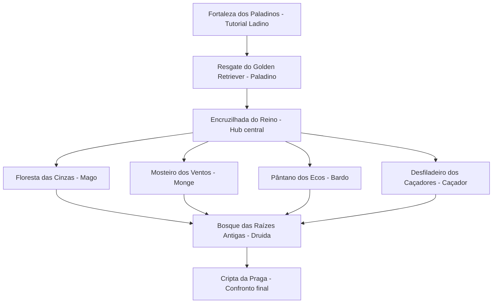

# Game Design Document — Sete Vidas

**Versão:** 0.1  
**Data:** 08/11/2026  
**Status:** Conceito inicial / pré-produção  
**Nome alternativo:** *Seven Lives: The Cursed Tome*

> **Visão central:** as sete vidas do gato não representam apenas sua saúde, mas também sete classes jogáveis. Cada coração recuperado desbloqueia uma nova maneira de lutar, explorar e resolver desafios.

---

## 1. Visão geral

| Campo | Definição |
|---|---|
| Nome provisório | Sete Vidas |
| Nome alternativo | Seven Lives: The Cursed Tome |
| Gênero | Metroidvania 2D |
| Subgêneros | Ação, plataforma, exploração, furtividade e RPG leve |
| Engine | Unity |
| Linguagem | C# |
| Plataforma inicial | PC (Windows/Steam) |
| Jogador | Single-player |
| Câmera | Lateral 2D |
| Público-alvo | Fãs de Hollow Knight, Ori e Dead Cells |
| Direção artística | Fantasia medieval com animais antropomórficos |
| Tema central | Redenção, confiança, sacrifício e reconstrução |

### Conceito principal

O jogador controla um pequeno gato ladino, integrante de um clã de ladrões, contratado para roubar um tomo mágico protegido por uma ordem de paladinos caninos.

O roubo desencadeia uma maldição que destrói seis de suas sete vidas. Salvo por um paladino Golden Retriever, o protagonista descobre que foi manipulado por uma capivara necromante para libertar uma praga ancestral.

Agora, com apenas uma vida restante, o gato precisa atravessar um reino em decadência, conquistar aliados e recuperar seus corações perdidos.

Cada novo coração representa uma classe, uma arma e um conjunto de habilidades que transforma a maneira como o jogador explora o mundo.

## 2. Pilares do jogo

### 2.1. Sete corações, sete classes

O protagonista mantém sua identidade de gato ladino, mas pode canalizar o poder dos companheiros para assumir diferentes estilos de combate.

### 2.2. Exploração com progressão não linear

Habilidades desbloqueiam passagens anteriormente inacessíveis, incentivando o jogador a revisitar regiões.

### 2.3. Combate com múltiplos estilos

Furtividade, força bruta, magia, mobilidade e controle de inimigos coexistem em um sistema de troca de classes.

### 2.4. Companheiros com histórias próprias

Cada coração recuperado está associado a um personagem importante e a uma missão narrativa.

## 3. História e narrativa

### 3.1. Prólogo — O último roubo

O protagonista pertence a um clã de ladrões felinos conhecido provisoriamente como **Clã das Sombras**. Especializados em infiltração e roubos impossíveis, seus integrantes possuem a reputação de entrar em qualquer fortaleza sem serem vistos.

Certo dia, um contratante misterioso oferece uma recompensa extraordinária para recuperar um tomo mantido na fortaleza da Ordem dos Paladinos Cães.

A missão parece simples: entrar, localizar o livro e escapar.

Durante a invasão, o jogador aprende as mecânicas iniciais de furtividade, escalada e ataques pelas costas.

Ao encontrar o tomo e removê-lo de seu pedestal, um selo ancestral se rompe.

Uma energia sombria atravessa o corpo do protagonista, consumindo suas sete vidas, uma após a outra.

Quando resta só a última centelha, o contratante aparece num clarão roxo.

Ele revela sua verdadeira identidade: uma **capivara necromante** que precisava de um ser com sete vidas para despertar o tomo, que só acorda bebendo vidas. Ele toma o tomo, joga uma moeda de ouro ao lado do gato ("o pagamento está feito pelos seus serviços") e some, deixando-o para morrer.

O paladino Golden Retriever, guardião da câmara, salva o gato e pede ajuda para recuperar e destruir o tomo. O gato jura, movido pela vingança contra quem o usou.

O gato nunca foi contratado para roubar o livro. Ele foi escolhido para servir como receptáculo da maldição.

O necromante desaparece levando o poder libertado, enquanto uma praga começa a se espalhar pelo reino.

### 3.2. A queda

O protagonista desperta entre os escombros da fortaleza.

Seis corações foram destruídos, e o sétimo está enfraquecido. A maldição continua dentro dele.

O Golden Retriever explica que a energia libertada corrompe animais, florestas e criaturas mágicas.

A única possibilidade de deter a praga é reconstruir o poder das sete vidas.

Entretanto, os corações perdidos não podem simplesmente ser recuperados: precisam ser reconstruídos por meio de vínculos mágicos com outros animais.

### 3.3. A jornada

Durante a aventura, o jogador encontra animais de diferentes classes. Cada um enfrenta as consequências da praga e possui seus próprios conflitos.

Ao ajudá-los, o gato estabelece um vínculo que permite reconstruir um coração.

Esses vínculos concedem poderes específicos, possibilitando alcançar novas regiões e enfrentar ameaças maiores.

### 3.4. Conflito final

A capivara necromante pretende utilizar o tomo para espalhar a praga e dominar as terras.

No confronto final, o protagonista terá recuperado suas sete vidas, não como um privilégio de nascimento, mas como resultado dos laços construídos durante a jornada.

**Direção narrativa sugerida:** o gato começa a história como alguém que rouba para benefício próprio e termina como alguém disposto a arriscar suas vidas para proteger os outros.

## 4. Sistema das sete vidas

Cada coração possui três funções: representar uma vida recuperada, armazenar o vínculo com uma classe e desbloquear habilidades de exploração.

### 4.1. Classes jogáveis

#### 1. Ladino — Gato protagonista

- **Disponibilidade:** classe inicial.
- **Arma:** duas adagas.
- **Habilidades:** agachar para furtividade, escalar paredes específicas, golpes rápidos e ataques pelas costas com dano aumentado.
- **Exploração:** atravessar passagens baixas e subir superfícies escaláveis.

#### 2. Paladino — Golden Retriever

- **Arma:** marreta sagrada.
- **Habilidades:** golpes pesados, dano divino e quebra de estruturas.
- **Exploração:** destruir paredes rachadas e escombros mágicos.

#### 3. Mago — Pato

- **Arma:** cajado arcano.
- **Habilidades:** projéteis de fogo, explosões e ataques elementais.
- **Exploração:** incendiar vinhas e ativar mecanismos mágicos.

#### 4. Monge — Panda-vermelho

- **Arma:** punhos e manoplas.
- **Habilidades:** combos de artes marciais, golpes aéreos e pulo duplo.
- **Exploração:** alcançar plataformas elevadas e superar obstáculos verticais.

#### 5. Bardo — Sapo

- **Arma:** instrumento musical.
- **Habilidades:** ondas sonoras, melodias que deixam o inimigo lento.
- **Exploração:** ativar dispositivos por ressonância.

#### 6. Caçador — Raposa 

- **Arma:** arco e flechas.
- **Habilidades:** dash horizontal, ataques à distância e flecha com corda.
- **Exploração:** atravessar grandes abismos e se pendurar em pontos de ancoragem.

#### 7. Druida — Lobo-guará

- **Arma:** Chicote de espinhos.
- **Habilidades:** invocar plataformas temporarias de flores e transformar-se em inseto.
- **Exploração:** acessar pequenas frestas e criar plataformas.

> A ordem das classes precisam refletir no leveldesing, para que melhore os movimentos do personagem progressivamente para termos pulo duplo e dash de uma forma funcional que evolua nosso personagen constantemente.

### 4.2. Regras dos corações

É importante separar **corações recuperados** de **pontos de vida atuais**.

Cada coração recuperado vale **2 hits** de vida máxima (alinhado com a seção 14). O jogador começa com um coração (2 hits) e pode chegar a sete (14 hits). Cada golpe inimigo comum tira 1 hit.

As classes permanecem desbloqueadas permanentemente após a recuperação de seus respectivos corações. Isso evita que o jogador perca uma habilidade essencial de exploração ao receber dano.

| Corações recuperados | Classes disponíveis na progressão exemplificativa |
|---|---|
| 1 | Ladino |
| 2 | Ladino, Paladino |
| 3 | Ladino, Paladino, Mago |
| 4 | Ladino, Paladino, Mago, Monge |
| 5 | Ladino, Paladino, Mago, Monge, Bardo |
| 6 | Ladino, Paladino, Mago, Monge, Bardo, Caçador |
| 7 | Todas as anteriores + Druida |

> A ordem é ilustrativa e pode variar conforme a estrutura não linear do mapa.

### 4.3. Troca de classes

O jogador poderá alternar entre as classes desbloqueadas em tempo real.

Cada troca altera a arma, as animações de ataque, as habilidades especiais e a capacidade de interagir com o cenário.

**Sugestão de controles para PC:**

| Ação | Controle |
|---|---|
| Movimento | A / D |
| Pular | Espaço |
| Agachar / Furtividade | S |
| Ataque principal | Mouse esquerdo |
| Habilidade especial | Mouse direito |
| Interagir | E |
| Trocar classe | Q / R |
| Seleção rápida de classe | Teclas 1–7 |
| Dash | Shift |

Os controles deverão ser remapeáveis. A versão final também deve oferecer suporte a controle.

## 5. Mecânicas de combate

### 5.1. Furtividade do Ladino

A furtividade deve funcionar como uma mecânica estratégica, não apenas uma animação.

O jogador entra em modo furtivo ao agachar, reduzindo ruídos e dificultando sua detecção. Porém, agachar não garante invisibilidade: iluminação, distância, direção do olhar e movimentação dos inimigos influenciam a percepção.

**Estados básicos de IA:**

1. **Patrulhando:** inimigo segue sua rota normal.
2. **Suspeito:** percebe movimento ou barulho.
3. **Investigando:** procura a origem da perturbação.
4. **Em combate:** persegue e ataca o protagonista.

Caso perca o jogador de vista, o inimigo deverá procurar na última posição conhecida antes de retornar à patrulha.

### 5.2. Ataque pelas costas

O Ladino recebe bônus de dano quando ataca um inimigo que está de costas.

| Situação | Multiplicador provisório |
|---|---:|
| Ataque comum | 1,0× |
| Ataque pelas costas | 1,5× |
| Ataque furtivo pelas costas | 2,5× |

Esses valores deverão ser ajustados durante os testes.

### 5.3. Combate entre classes

Cada classe deve oferecer vantagens diferentes. O Paladino é lento e causa alto dano, o Ladino possui ataques rápidos, o Mago atua à distância e o Bardo pode controlar grupos de inimigos.

A troca de classes deve ser útil durante o combate, mas não obrigatória a cada segundo.

Uma possibilidade futura é implementar combos entre classes, como adormecer um inimigo com o Bardo e realizar um ataque furtivo com o Ladino.

## 6. Estrutura do mundo

O mapa será interconectado, com áreas que podem ser revisitadas conforme novas habilidades são adquiridas.

### 6.1. Regiões iniciais propostas

| Região | Características | Habilidade associada |
|---|---|---|
| Fortaleza dos Paladinos | Castelo, masmorras e passagens secretas | Ladino / Paladino |
| Floresta das Cinzas | Vegetação corrompida e vinhas | Mago |
| Mosteiro dos Ventos | Torres, penhascos e plataformas | Monge |
| Pântano dos Ecos | Criaturas sonoras e guardiões adormecidos | Bardo |
| Desfiladeiro dos Caçadores | Abismos e estruturas suspensas | Caçador |
| Bosque das Raízes Antigas | Vegetação viva e túneis minúsculos | Druida |
| Cripta da Praga | Região final dominada pelo necromante | Todas |

### 6.2. Exemplo de progressão



Esse é um fluxo macro conceitual. No mapa definitivo, as regiões devem possuir atalhos, caminhos alternativos e conexões de retorno.

A progressão inicial pode ser parcialmente linear, mas, após adquirir o Paladino, o jogador deverá encontrar diferentes rotas possíveis.

## 7. Inimigos e chefes

Os inimigos serão animais e criaturas corrompidas pela praga. Nem todos os animais hostis precisam ser originalmente malignos: alguns podem estar sob influência do necromante.

### 7.1. Arquétipos básicos

- **Sentinela:** inimigo corpo a corpo; patrulha regiões.
- **Arqueiro:** ataca de plataformas ou posições elevadas.
- **Brutamontes:** inimigo lento, resistente e com golpes pesados.
- **Conjurador:** utiliza magia e ataques em área.
- **Caçador:** procura o jogador mesmo após perder contato visual.
- **Corrompido:** criatura contaminada com comportamento imprevisível.

### 7.2. Chefes

Cada região principal deverá possuir um chefe que explore a habilidade recém-adquirida ou que será desbloqueada.

Por exemplo, um guardião protegido por rochas pode exigir a marreta do Paladino, enquanto um chefe cercado por vinhas pode exigir o fogo do Mago.

A capivara necromante será a antagonista principal, mas poderá aparecer durante a campanha para demonstrar o avanço da praga e provocar o protagonista.

## 8. Exploração, checkpoints e morte

O jogo terá pontos de descanso distribuídos pelo mundo. Esses pontos permitem salvar o progresso, restaurar a vida e atualizar o mapa.

**Proposta de checkpoint:** pequenos santuários felinos ou altares ancestrais, relacionados à origem das sete vidas.

Quando os pontos de vida chegam a zero, o protagonista retorna ao último checkpoint, sem perder os corações e classes permanentemente recuperados.

A narrativa pode justificar esse retorno como uma manifestação da última centelha de vida do gato.

Um sistema de perda temporária de recursos após a morte pode ser considerado futuramente, mas não é necessário para a primeira versão.

## 9. Arquitetura técnica — Unity

Para o desenvolvimento, recomenda-se separar os sistemas de movimentação, combate, habilidades, classes, inimigos e progressão.

A arquitetura deve permitir adicionar novas classes sem modificar constantemente o código principal do personagem.

### 9.1. Tecnologias propostas

| Componente | Tecnologia |
|---|---|
| Engine | Unity 6 LTS |
| Linguagem | C# |
| Renderização | Universal Render Pipeline (URP 2D) |
| Input | Unity Input System |
| Câmera | Cinemachine |
| Mapas | Tilemap |
| Animações | Animator / Sprite Animation |
| Dados das classes | ScriptableObjects |
| Salvamento | JSON local |
| Versionamento | Git + GitHub |
| Testes | Unity Test Framework |

### 9.2. Organização do projeto

```text
Assets/
└── _Game/
    ├── Art/
    │   ├── Characters/
    │   ├── Environments/
    │   ├── Enemies/
    │   └── UI/
    ├── Audio/
    │   ├── Music/
    │   └── SFX/
    ├── Animations/
    ├── Prefabs/
    │   ├── Player/
    │   ├── Enemies/
    │   └── Interactables/
    ├── Scenes/
    │   ├── MainMenu/
    │   ├── Prologue/
    │   └── World/
    ├── Scripts/
    │   ├── Core/
    │   ├── Player/
    │   ├── Classes/
    │   ├── Combat/
    │   ├── Abilities/
    │   ├── Enemies/
    │   ├── World/
    │   ├── Progression/
    │   ├── Save/
    │   └── UI/
    ├── ScriptableObjects/
    └── Settings/
```

### 9.3. Componentes principais

| Sistema | Responsabilidade |
|---|---|
| PlayerController | Movimento, pulo e agachamento |
| PlayerHealth | Vida atual e dano recebido |
| ClassManager | Classes desbloqueadas e classe ativa |
| AbilityController | Execução das habilidades |
| CombatController | Ataques, dano e colisões |
| StealthController | Visibilidade, ruído e furtividade |
| EnemyAI | Patrulha, investigação e combate |
| HeartProgression | Recuperação dos sete corações |
| WorldInteraction | Objetos e obstáculos do mapa |
| SaveManager | Persistência do progresso |

### 9.4. Modelo de classes

Uma abordagem inicial é usar `ScriptableObject` para armazenar as configurações das classes.

```csharp
public enum CharacterClass
{
    Rogue,
    Paladin,
    Mage,
    Monk,
    Bard,
    Hunter,
    Druid
}
```

Cada classe deverá possuir uma definição de dados com atributos como:

```csharp
using UnityEngine;

[CreateAssetMenu(menuName = "Game/Class")]
public class ClassDefinition : ScriptableObject
{
    public CharacterClass ClassType;
    public string DisplayName;
    public Sprite Icon;

    public float AttackDamage;
    public float AttackSpeed;

    public GameObject WeaponPrefab;
}
```

As habilidades podem ser implementadas por componentes independentes, como `WallClimbAbility`, `DoubleJumpAbility` e `FireSpellAbility`.

Isso permite manter o mesmo personagem e trocar seu conjunto de habilidades conforme a classe selecionada.

**Decisão arquitetural importante:** as habilidades de exploração desbloqueadas devem continuar disponíveis quando necessário, sem obrigar o jogador a trocar constantemente de classe para realizar movimentos básicos. Essa regra precisa ser validada no protótipo, especialmente para pulo duplo e dash.

## 10. Interface do usuário

A interface deve ser minimalista, preservando o espaço disponível para exploração.

Elementos principais:

- Corações no canto superior esquerdo, indicando a vida atual e a vida máxima.
- Ícone da classe ativa próximo aos corações.
- Indicador de habilidade especial e tempo de recarga, quando aplicável.
- Minimapa ou mapa acessível por tecla.
- Menu de seleção de classes.
- Diário com missões e personagens encontrados.

O visual dos corações pode evoluir conforme a história: inicialmente quebrados ou escurecidos, passando a brilhar com símbolos próprios de cada classe recuperada.

## 11. Planejamento de desenvolvimento

A recomendação é não começar implementando as sete classes e o mundo inteiro. O primeiro objetivo será validar se controlar o gato, explorar e combater é divertido.

### 11.1. MVP — Protótipo jogável

**Escopo sugerido, com estimativa preliminar de 1–2 meses para desenvolvimento solo com assets temporários:**

- [ ] **Configuração do projeto Unity:** criar projeto 2D, Git e estrutura de pastas.
- [ ] **Movimentação do gato:** andar, pular e agachar.
- [ ] **Furtividade:** sistema de detecção por inimigos.
- [ ] **Combate com adagas:** ataque básico e ataque pelas costas.
- [ ] **Escalada:** paredes específicas escaláveis.
- [ ] **Inimigo básico:** patrulha, perseguição, ataque e morte.
- [ ] **Primeira área:** pequena seção da fortaleza.
- [ ] **Sistema de vida:** corações, dano e morte.
- [ ] **Primeiro checkpoint:** respawn e salvamento básico.
- [ ] **Paladino inicial:** troca de classe e destruição de obstáculos.

A estimativa não é um compromisso de prazo e depende da experiência da equipe, dos assets e do nível de acabamento.

### 11.2. Vertical Slice

Após validar o MVP, o próximo objetivo será criar uma pequena experiência com qualidade próxima da versão final.

Ela deverá incluir o tutorial da fortaleza, a cena do roubo, a maldição, a intervenção do Golden Retriever, um chefe ou encontro de combate marcante e a primeira recuperação de coração.

Esse trecho poderá servir como demonstração jogável do conceito.

### 11.3. Fases posteriores

| Fase | Objetivo |
|---|---|
| Pré-produção | Definir arte, mecânicas e escopo |
| Protótipo | Validar movimentação e combate |
| Vertical Slice | Produzir trecho completo e polido |
| Produção | Criar classes, regiões e chefes |
| Alpha | Jogo completo em funcionalidades |
| Beta | Balanceamento, testes e correções |
| Lançamento | Publicação para PC |

## 12. Riscos e decisões de design

**Complexidade das sete classes:** cada classe adiciona animações, armas, habilidades, efeitos e possibilidades de interação. É importante que todas compartilhem uma base técnica consistente.

**Balanceamento da furtividade:** o Ladino precisa continuar relevante mesmo após o desbloqueio de classes com ataques mais fortes.

**Dependências do mapa:** nenhum jogador deve ficar preso em uma região porque uma habilidade necessária está inacessível.

**Progressão de vida:** iniciar com um único coração pode tornar o jogo excessivamente difícil. Uma alternativa é cada coração representar um recipiente de vida com múltiplos pontos de resistência.

**Identidade do protagonista:** mesmo utilizando outras classes, o personagem deve continuar sendo visualmente reconhecível como o gato ladino. As classes podem modificar equipamentos, postura e efeitos, sem transformar o protagonista nos animais aliados.

## 13. Critérios de sucesso do primeiro protótipo

O MVP será considerado validado quando o jogador conseguir atravessar uma pequena área utilizando furtividade e escalada, derrotar inimigos com as adagas, executar ataques pelas costas, sobreviver a encontros de combate e desbloquear o Paladino para destruir um obstáculo antes inacessível.

Mais importante do que a quantidade de conteúdo será responder a três perguntas:

1. É divertido controlar o gato mesmo sem nenhuma classe adicional?
2. A furtividade e o combate oferecem escolhas interessantes?
3. Recuperar um coração e adquirir uma nova classe provoca uma sensação real de evolução?

## 14. Próximas decisões do projeto

A sugestão é manter o nome provisório **Sete Vidas** e estabelecer como diferencial principal a combinação de Metroidvania com múltiplas classes vinculadas aos corações.

Antes de iniciar o desenvolvimento, existem três decisões que merecem ser formalizadas:

1. O estilo artístico definitivo: pixel art.
2. A forma exata de alternar e combinar habilidades entre classes: As habilidades de locomoção como dash, pulo duplo, furtividade se pendurar vão funcionar em qualquer classe, outras como a plataforma do druida, musica do bardo e marreta do paladino, fogo são exclusivamente quando mudar a classe.
3. A relação entre os sete corações e o sistema de saúde: Cada coração são 2 hits para morrer.

A partir desse GDD, já existe uma base para criar o repositório, organizar as tarefas de desenvolvimento e começar pelo controlador do gato ladino.

---

**Fim do GDD v0.1.** Os conceitos representam uma base inicial; detalhes sugeridos permanecem sujeitos à validação durante a prototipagem.
