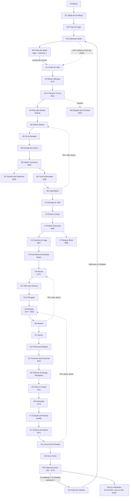

# Floresta Silenciosa — mapa, salas e progressão (F0, rev. 2)

> Plano geral: `Docs/Floresta/plano-implementacao.md`. GDD: `SeteVidasDocs/Castalia_GDD_Fase_02_Floresta_Silenciosa_v1_1.md`.
> **Rev. 2 (13/11/2026, pedidos do usuário):** mistura de trechos **horizontais e verticais**, com **muitas plataformas**, inspirada na *sensação*
> de Hollow Knight: Silksong (subir é o jogo; nada de copiar salas, inimigos ou visual). A fase é **uma subida gradual**: o gato cai no fundo do vale e,
> no fim, sai do **outro lado da ponte**.
> Status: **[PROPOSTA]**; vira graybox na F2.
> Métricas (`metricas.md`): pulo 4 (degraus de até 3), vão de até 4, agarrar borda 5, chaminé de pulo de parede com 3 de largura, escalada 4 tiles/s. **Pogo 7,2** (folga 6).

## 00. Rev. 4 — a repaginada (pedidos do usuário de 13/11/2026) [PROPOSTA]

Substitui as partes da Rev. 3 que conflitam com ela (posições, atalhos, inimigos). Fonte de verdade: `ForestLayout.cs` (versão 2).
Prévia: `Tools/LevelPreview/checar_floresta.ps1` gera também **`floresta_mapa.png`** (o anel inteiro). Para depurar uma sala:
`Tools/LevelPreview/sala_ascii.ps1 <cena> <sala>` (texto com o alcance tile a tile).

**A forma: um anel, não uma escada.** Posições escritas à mão, sem sobreposição (o alcance confere):

| Faixa | Salas | Direção |
|---|---|---|
| Fundo (y ≈ −215) | A1 → A2 → A3 → A4 (A5 opcional embaixo) → A6 | leste |
| Lado leste | B1 → B2 → B3 → B4 (B7 opcional) → B5 (B6 opcional) | subindo |
| Meio (y ≈ −140 a −60) | C1 → C2 (desce) → C3 → C4 → C5 (C7 opcional embaixo) → C6 (Ravina, desce até o fundo) | oeste |
| Árvore e alto | D1 (sobe) → D2 → D3 → D4 → E1 … E6 → F1 → G1 → G2 → G3 | leste, subindo |

A C passa por cima da A e da B, e a E passa por cima da C. Por isso os atalhos são passagens de verdade.
A subida total caiu de ~670 para ~290 tiles. A estrada e o mapa da floresta são regiões de mapa separadas e não precisam bater em coordenadas.

**As cenas de teste viraram salas da fase**, com o desenho do usuário inteiro (coordenadas da cena de teste + 6 em x):

| Cena de teste | Sala da fase | O que mudou |
|---|---|---|
| `Forest_Test_A` | **A3 O Primeiro Tronco** | porta à esquerda (vem da A2); saiu o santuário S-T1 (a A2, ao lado, tem o S-F1) |
| `Forest_Test_B` | **B1 Pé do Bosque** | o S-T2 virou **S-F1B**; a "porta interna" (teleporte do chão ao patamar) virou um **cipó que se solta do patamar** |
| `Forest_Test_C` | **D3 Refúgio** | o S-T3 virou **S-F3**; a cabana agora é a cena `Forest_D_Cabin`; a saída por cima leva à D4 |

As cenas `Forest_Test_*` continuam existindo (menu 20) como bancada de testes.

**Atalhos de verdade (estilo Dark Souls).** Nada de porta que teletransporta. Cada atalho abre do lado mais adiantado e grava a flag no save; os dois lados olham a mesma flag:

| Flag | Abre em | Leva a | Como |
|---|---|---|---|
| `atalho_ravina` | C6 Ravina (fundo, S-F2) | A2 Raízes Gêmeas (S-F1) | alçapão de raízes no chão; o cipó desce pela raiz pendurada da A2 |
| `atalho_lago` | C4 Caverna do Lago | A6 Galhos Baixos | alçapão no chão do lago → poço estreito (C4p) → cipó na parede da A6 |
| `atalho_musgo` | E4 Clareira do Musgo (S-F4) | C1 Entrada do Vale | alçapão → poço comprido (E4p) → cipó na raiz pendurada da C1 |
| `atalho_torre` | B4 Torre (topo) | o pé da torre | cipó solto do alto, a parede inteira vira subida |
| `atalho_patamar` | B1 (patamar) | o chão da B1 | tampa + cipó na parede (era a porta interna da cena de teste) |
| `atalho_raiz` | E2 (topo) | o vão da vinha da E2 | o cipó fecha o vão; a E2 vira subida rápida |
| `ponte_reconstruida` | R3 ↔ A1 | corda | (F9, sem mudança) |

Do lado fechado, o gato vê o cipó enrolado lá no alto (ou a tampa) e comenta se apertar E. O componente é o `ShortcutLink`, que também serve para portão de tranca de um lado só.

**Inimigos da floresta (pedido do usuário):**
- Sem templários vivos e sem alarmes: a praga infectou a Ordem. As patrulhas são **templários zumbis** (o zumbi da Fortaleza, de espada ou de escudo).
- Saíram os fios de alarme, as lanças, o fogo e o lançador de flechas.
- A **Serpente da Floresta** é nova: buraco, chocalho, bote de 3 tiles, esticada = pogo/ponto fraco, e uma variação que rasteja.
- Plantas carnívoras no chão, nas paredes e no teto.
- Totais: 25 serpentes, 26 plantas, 26 templários zumbis, 38 morcegos, 8 Galhos Secos e 4 Brotos. Também 27 cogumelos, 25 cactos e 43 sombras.

**Plataformas orgânicas:** terreno com morros e raízes (`Terrain`), massas de raiz com cantos arredondados (`Blob`) e raízes penduradas do teto (`Roof`), no lugar das escadas de galho alternadas. As vinhas vêm em trechos que não se ligam: entre um e outro, o pogo no cacto (B2, B4). Os espinhos ficam longe das portas e com vão para quicar.

**Regras que o alcance passou a conferir:**
- A planta não conta mais como pogo (só aceita na volta do bote). Era por isso que a plataforma do baú da B3 parecia alcançável.
- Vinha fora da parede vira chão sólido no jogo e pode tampar porta.
- Salas não podem se sobrepor.
- A folga de pulo considera o gato pisando na ponta do corpo além da borda, como nos pulos da `Forest_Test_A` testados pelo usuário.

**Baús de madeira:** W01–W19, mais que as 12 madeiras do Tobi. O W15 (D3) só se alcança com o Arqueiro, como na cena de teste.

**Santuários:** S-F1 (A2), **S-F1B** (B1), **S-F1C** (B4, pé da Torre), **S-F1D** (C4, patamar da chegada), S-F2 (C6), S-F3 (D3), **S-F3B** (E2, pé da subida), S-F4 (E4) e S-F5 (R5). S-F1C, S-F1D e S-F3B entraram em 13/11/2026 (pedido do usuário: santuários muito espaçados), cada um no fim de um atalho.

## 0. Rev. 3 — o que o graybox (F2) mudou [SUBSTITUÍDO EM PARTE PELA REV. 4]

O graybox está em `Assets/_Game/Editor/ForestLayout.cs` (fonte de verdade das salas; este documento guarda as intenções).
Prévia e alcance: `Tools/LevelPreview/checar_floresta.ps1` → `SeteVidasDocs/Referencias/floresta/floresta_<cena>.png`.

- **Tamanhos ajustados** para fechar as métricas: A3 30 × 30, A4 30 × 51 (3 telas, não 4), B6 25 × 25, E4 30 × 16, F1 40 × 28, E1–E3 redesenhadas. A subida real vai de y −220 (A1) a ~450 (topo da G3), uns 670 tiles: **três vezes** os 220 da rev. 2 (as salas verticais da tabela §7, empilhadas, já somavam isso). Cortar ou não é decisão do **playtest de escala**.
- **Buracos no teto** entre salas da mesma cena levam um galho de mão única no chão de cima (pula-se por baixo; baixo + pulo desce).
- **Atalhos (pedido do usuário):** cada um **abre do lado mais adiantado** ("E: descer…") e, aberto, funciona nos dois sentidos; do outro lado, antes disso: "Não abre deste lado".

  | Atalho | Abre em | Leva a | Como |
  |---|---|---|---|
  | AT1 | B5 Copa Baixa | A6 Galhos Baixos | cipó |
  | AT2 | D4 Mirante | C6 Ravina | cipó |
  | AT3 | G2 Coluna dos Primatas | D3 Refúgio | porta |
  | AT4 | R3 ↔ A1 | corda | só com `ponte_reconstruida` |
  | AT5 | C2 Raízes Caídas (topo) | B3 Jardim Carnívoro | raiz |
  | AT6 | C5 Estrada Negra (fim) | C1 Entrada do Vale | túnel |
  | AT7 | E4 Clareira do Musgo | E1 Sulcos | trilha (o retorno rápido antes do trecho sem volta) |
  | AT8 | A6 Galhos Baixos (saída) | A2 Raízes Gêmeas | raiz |

- **Antes do chefe dormindo (E1–E3), movimento encadeado (pedido do usuário):** E1 rampa 1:2 → vão de espinhos só com pogo → rampa 1:1 → descida correndo → pulo até a vinha do pilar; E2 rampas nos patamares jogam para o galho que balança e para a vinha, com um galho podre (plataforma temporária); E3 por cima: sobe até o alto, rampa 1 desce e cai na rampa 2, que lança para um galho podre sobre os espinhos. **20 ganchos** nas três salas e na E4: com o Caçador, o caminho contrário pelo alto.
- **Sem volta a partir da E5 (pedido do usuário):** da E4 o gato cai no focinho da E5, alto demais para voltar; E5 → E6 → F1 é furtividade contínua, e a F1 não tem saída para o oeste. Por isso o **S-F4 foi para a E4** (último santuário antes do trecho); morrer no trecho volta para a E4.
- **Furtividade em todas as regiões (pedido do usuário):** 60 sombras, 29 patrulhas (placeholders) e armadilhas (espinhos, serras, lâminas, fios de alarme, lanças, fogo, lançador de flechas) distribuídas pelas salas.

## 1. A forma da floresta: uma subida do fundo do vale até o outro lado da ponte

```
 y    0  OESTE ══ Fortaleza ══ R1 R2 R3 ═══ ponte caída ═══ R5 ══ Miaravéu  LESTE
                                     ┊ queda               ▲ G (saída)
 −35                                 ┊           ┌── F Coração ──┘
 −60                                 ┊       ┌── E Ninho ──┘
 −90                                 ┊   ┌── D Refúgio ──┘
 −120                                ┊ ┌─ C Vale ──┘
 −150                                ┊ B Bosque ──┘  (sobe)
 −190                     ┌── A Raízes da Queda ──┘
 −220                     └─ fundo do vale ─┘
```

1. A ponte de pedra desaba e o gato cai até o **fundo do vale** (y −200), amortecido por galhos e cipós.
2. Cada região fica **mais alta e mais a leste** que a anterior: Raízes → Bosque → Vale → Refúgio → Ninho → Coração.
3. Depois da Isyathy, uma última subida sai na **cabeceira leste (R5)**, o outro lado da ponte. A Tobi está lá.
4. A ponte reconstruída é **opcional** [APROVADO]: um bônus que **libera a volta para a Fortaleza**, abre a corda para a floresta e vai dar acesso a áreas futuras. A fase termina seguindo a estrada para Miaravéu, a leste.

**Leitura de progresso:** a ponte quebrada aparece **no alto do fundo** (parallax) em muitas salas e fica **maior e mais perto** conforme o gato sobe. O jogador sempre sabe quanto falta.

## 2. Regras de level design

**Sempre subindo aos poucos**
- Cada região termina **30–40 tiles mais alto** que começou. A saída de cada região é o ponto mais alto dela.
- Descidas existem, mas são **curtas e locais** (caverna, lago, ninho entre as escamas) e nunca baixam mais que 1 tela abaixo da entrada da região.
- Trechos horizontais andam para o **leste** e sobem em degraus suaves (terreno, rampas, ruínas).

**Mistura de horizontal e vertical**
- Alternar: **sala vertical → sala horizontal → sala vertical**. Nunca duas horizontais longas seguidas.
- **~55% das salas são verticais** (1 tela de largura × 2–4 de altura) e ~45% horizontais (2–3 telas de largura, com 2–3 alturas de plataforma).
- **Toda sala horizontal também tem altura**: pelo menos 2 níveis de plataforma (rota de cima e rota de baixo).
- Toda sala vertical tem **duas colunas de subida** (uma fácil, uma rápida ou arriscada) que se cruzam pelo menos uma vez.

**Densidade de plataformas**
- Na rota principal, **um apoio a cada 3 tiles de altura**: galho, borda, parede escalável ou alvo de pogo. Vão horizontal de até 4.
- **Cair custa tempo, não vida.** Embaixo de trechos difíceis há um patamar de recuperação no máximo 2 telas abaixo. Abismo mortal só na sala-desafio opcional (B7), com aviso.
- Cada sala mistura **pelo menos 2** formas de subir: pulo, escalada, pulo de parede, pogo, plataforma especial (§3).
- Inimigos ficam **sobre plataformas** e em pontos de passagem; Morcegos e Cactos ocupam o vazio entre elas.

**Ritmo**
- A cada ~2 telas de subida, um **patamar** largo (≥ 6 tiles), sem inimigos, às vezes com placa, baú ou vista.
- O topo das salas verticais tem **recompensa visual**: a ponte mais perto, a lua, a silhueta da Isyathy (§6).

**Salas-hub com 3 saídas [APROVADO, pedido do usuário 13/11/2026]**
- Cada região tem pelo menos uma **sala-hub** com aberturas para **3 salas de desafios diferentes**. Exemplo (cena de teste C, a Encruzilhada):
  1. **Sala da chave**: quebrar um tronco rachado para pegar a chave.
  2. **Sala-arena**: vários inimigos; ao entrar, os portões fecham; derrotados todos, abrem para sempre (morrer reabre).
  3. **Subida até uma porta trancada**: a **cabana da Vulpis** (D3 Refúgio), que só abre com a chave.
- As três saídas são legíveis do hub (placas provisórias, depois por arte: luz, flechas, grades) e voltam para ele.

**Câmera (F1)**
- Cinemachine com zona morta vertical menor que a horizontal; ao cair mais de 1 s, a câmera **olha para baixo**.
- Agachado e parado por 0,6 s, a câmera desce 4 tiles para o gato ver o que tem embaixo.

## 3. Plataformas novas (mecânicas na F1)

| Tipo | Comportamento | Leitura visual |
|---|---|---|
| **Galho de mão única** | atravessa pulando por baixo; **baixo + pulo** desce por ele | galho fino, folhas só por cima |
| **Galho que balança** | afunda 0,25 tile com o peso e volta | galho comprido, curvado |
| **Galho podre** | quebra 0,6 s depois de pisar, volta em 5 s (`CrumblingPlatform`) | casca cinza, lascas caindo |
| **Folha larga** | afunda devagar com o gato em cima (1 tile/s, até 3 tiles); sobe quando ele sai | folha gigante verde-clara |
| **Cogumelo saltador** | quica sozinho a 6 tiles ao cair em cima | chapéu turquesa (a cor do pogo) |
| **Espinho de pogo** | já existe (`PogoSurfaces`) | ponta turquesa |

## 4. Escala

- A Fortaleza tem **10 salas**. A Floresta tem **39**, em 7 cenas (uma por região).
- Subida total: **~220 tiles** (a Fortaleza tem 129 de altura).

| Cena | Região | Salas | Altura (y) | Forma |
|---|---|---:|---|---|
| `Forest_Road` | Estrada, ponte e as duas cabeceiras | 5 | 0 | horizontal |
| `Forest_A_Roots` | A Raízes da Queda | 6 | −220 a −185 | fundo do vale: horizontal + poço |
| `Forest_B_Thorns` | B Bosque dos Espinhos | 7 | −190 a −150 | **vertical** (pogo) |
| `Forest_C_Shadows` | C Vale das Sombras | 7 | −155 a −120 | **horizontal** com cavernas |
| `Forest_D_Refuge` | D Refúgio da Vulpis | 4 | −125 a −90 | **vertical** (árvore gigante) |
| `Forest_E_Nest` | E Ninho Adormecido | 6 | −95 a −60 | **horizontal** subindo pelas escamas |
| `Forest_F_Heart` | F Coração + saída | 4 | −65 a 0 | arena + **subida final** |

## 5. Grafo de progressão



**Ponte e corda:** a corda fica **no início da ponte, do lado da Fortaleza (R3)** [APROVADO] e desce até o fundo do vale (A1). Quem volta da Fortaleza entra na floresta por ela.

## 6. A Isyathy vista de longe [APROVADO]

Durante a exploração, antes do ninho, ela aparece **só no fundo** (parallax, sem colisão, nunca ataca):

| Sala | O que aparece | Gatilho |
|---|---|---|
| A4 Poço das Raízes | **dois olhos** amarelo-esverdeados entre as raízes; piscam e somem | primeira vez no topo do poço |
| B4 Torre Enferrujada | **silhueta** de um corpo passando atrás das copas distantes | ao chegar ao topo |
| C4 Caverna do Lago | **olhos refletidos** no lago; somem quando o gato agacha para olhar | ao entrar na ilha |
| C6 Ravina | curva de **escamas** se mexendo atrás da névoa | ao subir |
| D4 Mirante | o **corpo inteiro** enrolado no alto do vale, à frente (revelação; leva ao ninho) | sempre |

Regras: nunca numa sala com combate; uma vez por visita; respiração muito baixa junto.

**Depois da morte [APROVADO]:** a Isyathy morre de verdade, mas o **espírito** dela fica livre na floresta. Nos mesmos 5 lugares, no lugar dos olhos doentes, aparece o espírito (translúcido, azul-claro e âmbar, olhos calmos), agora **no primeiro plano e com quem dá para falar** (Interagir: D-ISYATHY-ESPIRITO-02, em rodízio). Sem colisão, sem perigo. A floresta fica um pouco mais clara (menos névoa, mais vagalumes).

## 7. Salas

**Legenda:** L × A em tiles (tela = 30 × 17); **H** = horizontal, **V** = vertical; S = santuário; W = baú; AT = atalho.

### Estrada de Soluki (`Forest_Road`, y 0)

| Sala | L × A | Conteúdo | Saídas |
|---|---|---|---|
| R1 Saída da Fortaleza | 30 × 17 H | Liga à "Estrada para Miaravéu" do `Fortress_MVP`. Posto abandonado, tocha, 1 Sentinela Infectado (espada) | ← Fortaleza · → R2 |
| R2 Posto de Vigia | 45 × 25 H | Torre de vigia caída com 3 andares de plataformas; Infectado (escudo) embaixo: chegar por cima e cair nas costas dele (tutorial do escudo) | → R3 |
| R3 Cabeceira oeste | 30 × 17 H | Pilar da ponte, marco "Ponte do Último Marco". Depois da ponte nova: **corda (AT4)** até o fundo do vale | → R4 · ▼ A1 (AT4) |
| R4 Ponte do Último Marco | 60 × 17 H | **Antes:** pedra; fuga + **cutscene 1**: a câmera acompanha a queda pela copa até o fundo. **Depois:** madeira, liga R5 a R3 | ▼ A1 (queda) |
| R5 Cabeceira leste | 30 × 17 H | Saída da subida final (G3). **Tobi**, **S-F5**, marco "Miaravéu, adiante" | ← R4 (ponte nova) · → Miaravéu |

### A — Raízes da Queda (`Forest_A_Roots`): fundo do vale, intensidade baixa

| Sala | L × A | Conteúdo | Saídas |
|---|---|---|---|
| A1 Fundo do Vale | 45 × 25 H | Onde o gato acorda, em galhos e cipós rasgados. Bem no alto, a ponte quebrada, minúscula. Recebe a corda (AT4) | → A2 |
| A2 Raízes Gêmeas | 45 × 25 H | **S-F1** num patamar entre duas raízes; primeira folhagem alta; P-PRIM-01. Duas alturas de raiz | → A3 |
| A3 O Primeiro Tronco | 30 × 34 V | Tutorial vertical: galhos de mão única e parede escalável. Patamar com o **tronco rachado** (tutorial do martelo) e **W01**. Embaixo, outro tronco rachado leva a A5 | ▲ A4 · ▼ A5 |
| A4 Poço das Raízes | 30 × 68 V | Subida de 4 telas dentro de uma raiz oca gigante: galhos de mão única, folhas largas, 2 Morcegos. Olhos da Isyathy (§6) | ▲ A6 |
| A5 Estação dos Primatas (opcional) | 60 × 25 H | Plataforma de estação soterrada, vagões em 2 andares, árvore atravessando o teto. P-PRIM-02. **W02** no teto do vagão (pulo de parede) | ← A3 |
| A6 Galhos Baixos | 60 × 34 H | Travessia para o leste em **3 alturas** de galhos (balançam), 1 Galho Seco disfarçado, sombra larga. Recebe o cipó AT1 | → B1 |

### B — Bosque dos Espinhos (`Forest_B_Thorns`): pogo, vertical

| Sala | L × A | Conteúdo | Saídas |
|---|---|---|---|
| B1 Pé do Bosque | 30 × 34 V | **Tutorial do pogo**: espinhos e cogumelos sobre patamares seguros; degrau final de 6 tiles exige pogo | ▲ B2 |
| B2 Escada de Cactos | 30 × 51 V | Cactos Flutuantes em linha (6 tiles entre eles) alternando com galhos de mão única | ▲ B3 |
| B3 Jardim Carnívoro | 60 × 25 H | Plantas Carnívoras em plataformas de 2 alturas: pogo no recuo. **W03** no alto | → B4 · ↑ B7 |
| B4 Torre Enferrujada | 20 × 51 V | Torre metálica dos Primatas: escada quebrada, trepadeiras escaláveis, cactos nos vãos. No topo, tronco rachado → **W04**, P-PRIM-04, vista da ponte e silhueta da Isyathy | ▲ B5 |
| B5 Copa Baixa | 60 × 25 H | Galhos largos entre as copas, Morcegos. Cipó (AT1) para descer até A6 | → C1 · ↑ B6 · ▼ A6 (AT1) |
| B6 Mirante da Copa | 30 × 25 H | (respiro) Patamar com placa, moedas e vista; sem inimigos | ← B5 |
| B7 Desafio dos Espinhos (opcional) | 30 × 68 V | Subida só de pogo (cactos, espinhos, cogumelos, 1 Planta), sem chão: cair volta ao começo. **W05** no topo | ↓ B3 |

### C — Vale das Sombras (`Forest_C_Shadows`): furtividade, horizontal

| Sala | L × A | Conteúdo | Saídas |
|---|---|---|---|
| C1 Entrada do Vale | 60 × 25 H | Escuro, folhagem alta em 2 alturas de terreno. 2 Serpentes nos buracos | → C2 |
| C2 Raízes Caídas | 30 × 51 V | **Duas colunas** de subida: galhos (Galho Seco disfarçado) ou sombra na parede (Serpentes) | ▲ C3 |
| C3 Prédio Soterrado | 45 × 51 V | **Prédio dos Primatas enterrado de pé**: cada andar é uma plataforma; janelas, escadas quebradas, raízes. Subir andar por andar. 2 Sentinelas Infectados + 1 Galho Seco infectado; dá para passar pelas janelas sem lutar. P-PRIM-03. **W06** num escritório trancado (furtividade) | ▲ C4 · → C7 |
| C4 Caverna do Lago | 60 × 25 H | (pequena descida) Lago escuro com cogumelos e folhas largas sobre a água. Serpentes infectadas. **W07** numa ilha (rota furtiva). Olhos no lago | → C5 |
| C5 Escombros da Estrada Negra | 75 × 25 H | Estrada dos Primatas subindo em rampa entre carcaças e postes tombados. Duas rotas: em cima, pelos postes; embaixo, pela sombra | → C6 |
| C6 Ravina | 30 × 51 V | **S-F2** na base. Subida pela parede da ravina (escalada + pulo de parede). Recebe AT2 | ▲ D1 |
| C7 Bosque Morto (opcional) | 30 × 51 V | Primeiro trecho forte da praga, galhos podres, Galhos Secos e Planta infectados. **W08** no topo | ← C3 |

### D — Refúgio da Vulpis (`Forest_D_Refuge`): a árvore gigante, vertical

| Sala | L × A | Conteúdo | Saídas |
|---|---|---|---|
| D1 Trilha das Flechas | 30 × 51 V | Flechas cravadas no tronco servem de **degraus** de 1 tile | ▲ D2 |
| D2 O Resgate | 45 × 17 H | **Cutscene da Vulpis** num galho largo | → D3 |
| D3 Refúgio | 30 × 51 V | Casa da Vulpis em **3 níveis** com pontes de corda, lanterna âmbar, **S-F3**. **W09** no telhado (pogo nos espinhos). Recebe AT3 (de G2) | ▲ D4 |
| D4 Mirante | 45 × 17 H | Topo da árvore: o **corpo da Isyathy** enrolado na encosta acima. Cipó (AT2) até C6 | → E1 · ▼ C6 (AT2) |

### E — Ninho Adormecido (`Forest_E_Nest`): furtividade, horizontal subindo

Medidor de alerta ativo em toda a cena (`Docs/Design/floresta-mecanicas.md` §4). O ninho fica numa **encosta**: o corpo da Isyathy forma "degraus" no fundo, e o gato sobe entre as voltas dele.

| Sala | L × A | Conteúdo | Saídas |
|---|---|---|---|
| E1 Sulcos | 60 × 25 H | Troncos esmagados, ossadas, sulcos subindo a encosta. Medidor ligado, sem galhos frágeis: ensina o feedback | → E2 |
| E2 A Raiz que Respira | 30 × 51 V | A "raiz" do fundo se mexe (D-NINHO-01). Subida com **galhos que tremem** com o alerta ≥ 50; quedas levam a patamares, nunca à morte | ▲ E3 |
| E3 Travessia das Escamas | 60 × 34 H | **Duas rotas**: em cima (galhos, longa e silenciosa) ou embaixo (tronco rachado, curta, +60 de alerta, **W10**) | → E4 |
| E4 Clareira do Musgo | 30 × 17 H | **Checkpoint do ninho**. O alerta cai rápido | ▲ E5 |
| E5 Olho no Fundo | 45 × 34 V | A cabeça dorme ao fundo. Subida em zigue-zague diante dela. **W11** num nicho embaixo do focinho | → E6 |
| E6 Antessala | 30 × 17 H | **S-F4**. A música some | → F1 |

### F — Coração e saída (`Forest_F_Heart`)

| Sala | L × A | Conteúdo | Saídas |
|---|---|---|---|
| F1 Coração da Floresta | 40 × 30 | Arena com 3 alturas de plataforma (`floresta-mecanicas.md` §7) | ▲ G1 (depois de vencer) |
| G1 Clareira do Espírito | 45 × 25 H | Logo depois da arena: menos névoa, vagalumes, o céu clareando. O espírito da Isyathy pode aparecer aqui também. **W12** num desvio | ▲ G2 |
| G2 Coluna dos Primatas | 20 × 51 V | Poço de elevador sem elevador: pulo de parede entre paredes de concreto, cogumelos. Porta (**AT3**) que desce até D3 | ▲ G3 · ▼ D3 (AT3) |
| G3 Sob a Ponte | 30 × 51 V | Última subida pelo pilar leste da ponte quebrada. **Aurora** no topo | ▲ R5 |

## 8. Baús de Madeira de Reconstrução

Todos alcançáveis com **Ladino + Paladino**. Nenhum depende de habilidade futura.

| Baú | Sala | O que exige | Desafio |
|---|---|---|---|
| W01 | A3 | martelo (tutorial) | nenhum |
| W02 | A5 | martelo + pulo de parede | exploração |
| W03 | B3 | pogo na planta | pogo |
| W04 | B4 | subida da torre + martelo | vertical |
| W05 | B7 | subida só de pogo (opcional) | pogo difícil |
| W06 | C3 | furtividade num andar do prédio | furtividade |
| W07 | C4 | furtividade na ilha | furtividade |
| W08 | C7 | galhos podres + infectados (opcional) | combate |
| W09 | D3 | pogo no telhado | pogo |
| W10 | E3 | rota baixa + martelo (+60 de alerta) | furtividade arriscada |
| W11 | E5 | furtividade diante da cabeça | furtividade difícil |
| W12 | G1 | desvio | exploração |

**Por região (GDD §7):** A 2 · B 3 · C 3 · D 1 · E 2 · F 1 = **12**.

## 9. Santuários, viagem rápida e atalhos

| Id | Sala | Viagem rápida |
|---|---|---|
| S-F1 | A2 Raízes Gêmeas | sim |
| S-F2 | C6 Ravina | sim |
| S-F3 | D3 Refúgio | sim |
| S-F4 | E6 Antessala | sim |
| S-F5 | R5 Cabeceira leste (ao lado da Tobi) | sim |
| (checkpoint) | E4 Clareira do Musgo | não |

Como a fase sempre sobe, **voltar é descer**: os atalhos são cipós e portas que levam rápido para regiões de baixo.

| Atalho | Liga | Como abre |
|---|---|---|
| AT1 | B5 → A6 | cipó solto do lado B |
| AT2 | D4 → C6 | cipó solto do lado D |
| AT3 | G2 → D3 | porta aberta do lado G |
| AT4 | R3 ↔ A1 | corda no início da ponte (`ponte_reconstruida`) |

**Viagem rápida:** os santuários da Floresta só se ligam aos da Fortaleza depois de `ponte_reconstruida` (antes disso, a cabeceira leste não tem caminho para o oeste).

## 10. Simulação sem softlock

- Da queda até F1, toda saída obrigatória exige só pulo, escalada, pulo de parede, pogo ou martelo: o gato tem tudo ao sair da Fortaleza.
- Toda descida (cipó, porta, queda) cai numa sala que **sobe de volta** pela rota normal.
- No ninho, galhos destruídos se refazem ou caem num patamar que volta por escalada.
- Depois da Isyathy: de R5, a viagem rápida leva a qualquer santuário da floresta; AT3 desce até o Refúgio. Buscar madeiras é rápido.
- A ponte é **opcional**: a fase termina pela estrada de Miaravéu sem ela. Sem 12 madeiras ou 20 moedas, a Tobi só não constrói; as madeiras estão alcançáveis e há moedas de sobra (Fortaleza: 153 no MVP; Floresta: meta de ~40 no mundo).

## 11. Ritmo

| Trecho | Direção | Intensidade | Respiro |
|---|---|---|---|
| R1–R4 | → | média → alta | A1–A2 |
| A1–A6 | → ▲ | baixa | — |
| B1–B7 | ▲ | média | B6 |
| C1–C7 | → ▲ | média | S-F2 (C6) |
| D1–D4 | ▲ | baixa | — |
| E1–E6 | → ▲ | alta | E4, S-F4 |
| F1 | — | muito alta | G1 |
| G1–G3, R5 | ▲ | baixa (vitória, aurora, Tobi) | — |

## Em aberto

1. Tamanho real das salas: confirmar no graybox (F2) cronometrando a rota.
