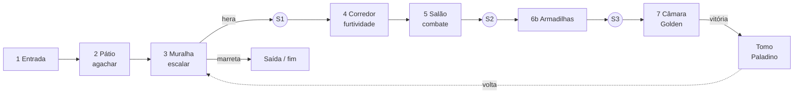

# Fortaleza dos Paladinos — área do MVP (Fase 6)

Cena: `Scenes/World/Fortress_MVP`, gerada por **Tools > Sete Vidas > 13. Fase 6: Fortaleza**. É onde o **Novo jogo** começa. A Playground continua sendo só a área de testes (menu "Área de testes", com save separado).
Coordenadas em tiles. Chão de baixo com topo em y 0; **andar de cima com topo em y 14**.

> O gerador recria a cena do zero. Quando for ajustar a Fortaleza à mão, pare de rodar o menu 13 e edite a cena direto.

## Esboço

```
 y 24 ───────────────────────────────────────────────────────────────────────────────────── teto
        [3 MURALHA]   S1  [4 CORREDOR]      [5 SALÃO]        S2 [6b ARMADILHAS]   S3 ┃[7 CÂMARA]┃[TOMO]
 y 14   hera ▲   ═══════ sombra ▓ passarela ═ sombra ▓ fio ═ plataformas ═══════ fogo ⌂ serra ▁fosso▁ ┃ Golden  ┃  📕
        (y 4-13) │                                                                         grade      grade
 y 12   ═════════╪═ andar de cima (maciço embaixo a partir de x 93) ══════════════════════════════════════════
                 │ [SAÍDA] ▓ parede rachada (x 76) → saída (x 88) → fim da demonstração
 y 0  [1 ENTRADA] ═╗[2 PÁTIO: fio + passagem baixa]╔═ [3 chão da muralha]
      pedras 2/3, fosso de 4 com espinhos
      x 0 ......... 32 ......................... 60 ............ 74 ........ 93 ............ 150 ....... 187 ... 218 . 226
```

## Fichas das salas

### Sala 1 — Entrada externa
Região: Fortaleza (fora) | Propósito: tutorial de andar e pular | Tamanho: 32 × 10 | x 0–31, chão em 0
- Narração de chegada (uma vez só): "A Fortaleza dos Paladinos..." / gato: "Entrar, pegar, sair."
- Pedras de **2** e **3** tiles (x 9–11 e 14–16): 3 é o máximo confortável (pulo de 4, folga de 1).
- Fosso de **4** tiles (x 20–23) com **espinhos** no fundo: pular ensina o limite de distância (4 = folga de 1 sobre o máximo de 5). Cair = 1 hit e volta ao chão seguro.
- Placa: "Espaço: pular". Entradas: spawn em x 3. Saída: arco de 4 tiles de altura na muralha (x 32).
- Risco de softlock: nenhum (o fosso tem 2 de fundo; os espinhos devolvem o gato).

### Sala 2 — Pátio
Propósito: agachar e passagem baixa | Tamanho: 26 × 8 | x 34–59, teto em 8
- **Passagem baixa** de 1 tile (x 42–47): só agachado.
- **Fio de alarme** (x 38,5) logo antes dela, ligado a um lançador de flechas na boca da passagem (x 41,6, atirando para a esquerda na altura do peito). Agachado: passa por baixo do fio e as flechas passam por cima.
- Placa: "S: agachar". Risco de softlock: nenhum (a passagem é atravessável nos dois sentidos).

### Sala 3 — Muralha
Propósito: escalada + **ver a parede rachada antes do Paladino** | Tamanho: 14 × 24 | x 60–73
- **Hera escalável** (x 72–73, de y 4 a 13): a única forma de chegar ao andar de cima (14 tiles: muito acima do pulo de 4 e do agarrar borda de 5). Começa em y 4: o gato pula e gruda.
- Embaixo da hera, a passagem continua para a **parede rachada** (x 76, rachaduras douradas, 4 tiles) com a coluna acima dela fechada até o andar de cima: **só quebrando** se passa. Placa: "rachaduras douradas... precisa de força".
- Atrás dela: a **saída** da fortaleza (x 88) → fim da demonstração.
- Santuário **S1 "Alto da muralha"** (x 76,5, andar de cima), logo depois de subir.

### Sala 4 — Corredor patrulhado
Propósito: furtividade e ataque pelas costas | Tamanho: 38 × 10 | x 74–111, chão em 14
- **Sentinela** patrulhando x 89–96 (7 tiles a 2 tiles/s = 3,5 s por perna + pausa de 1,5 s).
- **Sombras** nas duas pontas (x 76–86 e 99,5–107,5), **mato** em x 93,5.
- **Passarela** (x 86–98, topo em 19), alcançada pela hera de 1 tile em x 85 (dentro da sombra). Ela bloqueia a visão da Sentinela. **Pendurar e soltar** na ponta (x 98) é silencioso; cair direto (5 tiles) faz barulho.
- **Fio de alarme sem armadilha** (x 104, na sombra B): de pé, mostra "ALARME!" e faz barulho que se ouve no corredor inteiro (16 tiles): a Sentinela fica "?" e vem investigar o fio.
- Três soluções: por cima (passarela), pelas costas (sombra/mato → golpe furtivo de 5 = 1 golpe), ou lutando.

### Sala 5 — Salão de combate
Propósito: luta aberta | Tamanho: 30 × 10 | x 112–141
- **Duas Sentinelas**: x 116–124 (começa olhando para a direita) e x 128–136 (olhando para a esquerda). Plataformas (topo em 18) para fugir ou atacar por cima; mato em x 127.
- Placa: "clique: adagas · por trás dói mais". Inimigos podem soltar meio coração (15%).

### Sala 6 — Santuário e corredor das armadilhas
- **S2 "Depois do salão"** (x 143,5).
- **Fogo** (6 jatos, x 149,5–161,5, em onda) com plataformas a cada 2 tiles (topo em 17).
- **Serra** (x 167–173) com plataforma por cima (x 168–171).
- **Fosso** de 6 (x 176–181) com espinhos e duas **plataformas frágeis**.
- **S3 "Antes da câmara"** (x 184,5).

### Sala 7 — Câmara do Golden e sala do tomo
- Arena x 187–218 (9 de altura), grades em x 186,5 e 218,5. Golden em x 207 (ver `Docs/Design/chefe-golden.md`).
- Sala do tomo (x 220–224): pegar o tomo → maldição (7 → 1) → **o Contratante (capivara necromante) toma o tomo, joga uma moeda de ouro e some** → o Golden salva o gato → juramento por vingança → **Paladino**. A moeda fica no chão.

### Volta e saída
Com o Paladino, voltar pelo andar de cima até a muralha, descer (cair 14 tiles não machuca), quebrar a parede rachada (2 marretadas) e sair → **fim da demonstração** (volta à tela inicial).

> **Diferença do plano original:** o documento "Primeiros passos" falava em "atalho para o início". Aqui a parede rachada abre a **saída da fortaleza**, que encerra a demonstração. Fica no mesmo lugar (vista antes, aberta depois) e dá um fim claro ao MVP.

## Grafo de progressão



## Checagem anti-softlock (só com o Ladino, depois com o Paladino)
1. **Só Ladino (início):** Entrada → Pátio (agachar) → Muralha (escalar) → andar de cima → Corredor → Salão → Armadilhas → Câmara. Todas alcançáveis com andar, pular, agachar e escalar. A parede rachada está **visível** e **fechada**. ✔
2. **Volta de qualquer sala:** o andar de cima tem chão contínuo até a muralha; da muralha se desce caindo ou pela hera; o pátio e a entrada se atravessam nos dois sentidos. Nenhuma sala fica sem caminho até um santuário. ✔
3. **Câmara:** a grade de trás só fica fechada durante a luta; morrer ou descansar reabre. Vencido, as duas grades ficam abertas para sempre (flag no save). ✔
4. **Tomo:** fechar o jogo no meio da maldição deixa o Golden de pé ao lado do pedestal; falar com ele faz o juramento. ✔
5. **Com o Paladino:** a parede rachada (Heavy) é o único gate de classe e leva à saída. ✔
6. **Fossos com espinhos:** os espinhos devolvem ao último chão seguro; os fossos têm só 2 tiles de fundo. ✔
7. **Tempo entre santuários:** início → S1 ≈ 1–2 min; S1 → S2 ≈ 1–2 min; S2 → S3 ≈ 1 min; S3 → chefão imediato. ✔ (meta: ≤ 2–3 min)

**Resultado: nenhum softlock.**

## Cenário: a Cidadela da Ordem
A Fortaleza é a **Cidadela da Ordem dos Paladinos Cães**, onde filhotes viram templários e templários viram paladinos (lore: `Docs/Narrativa/lore.md`).
- **Entrada:** estátua de um cão paladino guardando o arco; estandarte carmesim com o emblema (pata sobre marreta).
- **Pátio dos Escudeiros:** dois **bonecos de treino de verdade** (um olhando para cada lado: ensinam o golpe pelas costas antes do corredor), alvo de arco, suporte de armas de madeira, estandarte e a placa D-PLACA-01.
- **Muralha:** estandartes longos e outra estátua vigiando a hera.
- **Alojamento (corredor):** tochas **só no trecho iluminado** do meio (o contraste com as sombras é leitura de furtividade) e a placa D-PLACA-02.
- **Salão de armas:** vitrais azul e dourado, fileira de escudos da Ordem e a placa do juramento (D-PLACA-03).
- **Câmara do Selo:** placa D-PLACA-04 na entrada, duas estátuas, vitrais e o grande estandarte do selo.
- Todo o cenário fica **atrás** de personagens e armadilhas e não tem colisão: não muda nenhuma medida nem a checagem anti-softlock.
