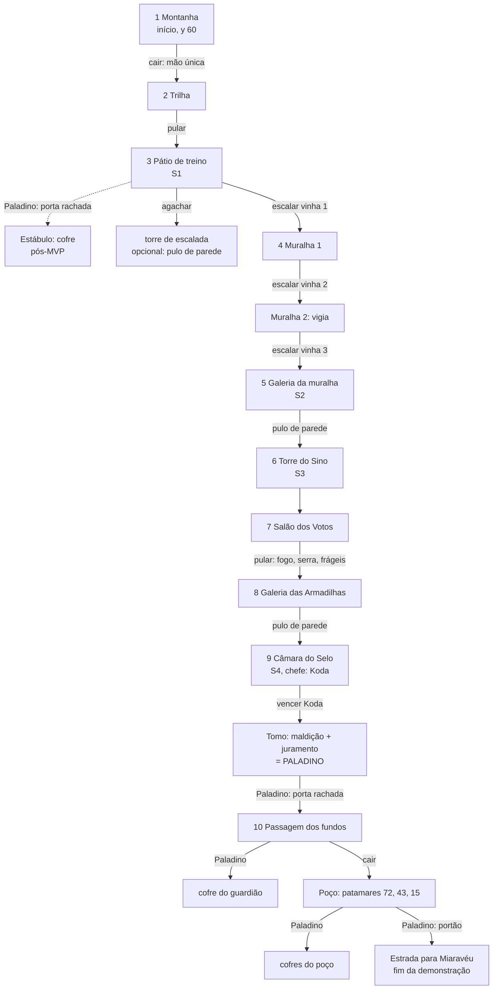

# Mapa e dependências (grafo de progressão)

Gerado a partir de `Docs/Level/fortaleza-mvp.md`. Cada seta diz o que é preciso para passar.

## Requisitos por conexão

| De → para | Requisito |
|---|---|
| Montanha → Trilha | nenhum (queda, mão única) |
| Trilha → Pátio | pulo |
| Pátio → Muralha 1 | escalar |
| Pátio → Estábulo | Paladino (volta pós-MVP) |
| Muralhas → Galeria | escalar |
| Galeria → Torre do Sino → Salão | escalar + pulo de parede |
| Salão → Galeria das Armadilhas | pulo |
| Galeria das Armadilhas → Câmara | escalar + pulo de parede |
| Câmara → Tomo | vencer o chefe |
| Tomo → Passagem → Poço → Estrada | Paladino |

**Simulação:** só com o Ladino, tudo até a Câmara é alcançável. O Paladino é ganho antes do primeiro gate obrigatório de marreta. Nenhuma sala alcançável fica sem caminho de volta a um santuário: na descida, morrer devolve ao S4. **Sem softlock.**
